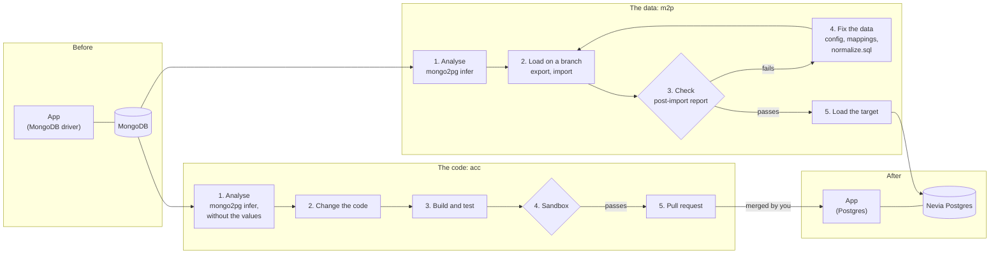
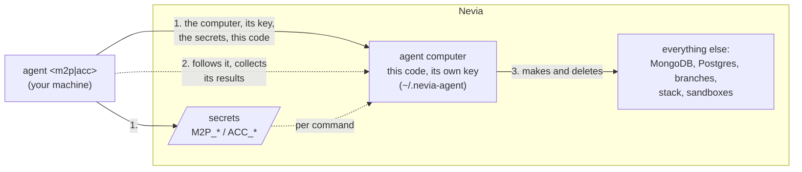

# nevia-agent

Two AI agents on [Nevia](https://nevia.cloud) that take an application from MongoDB to PostgreSQL, each on
one half of the migration. Everything runs on Nevia; here, only the `agent` CLI.

| Agent | Moves | With | Gives you |
| --- | --- | --- | --- |
| [**m2p**](docs/m2p.md) | the **data** | an AI agent and [mongo2pg](https://github.com/pmpetit/mongo2pg) | a Postgres loaded and checked by mongo2pg's post-import report, and the SQL it took |
| [**acc**](docs/acc.md) | the **code** | an AI agent | a pull request, tested on a sandbox of the app (also for any feature you describe) |

The AI agent is Claude Code, or GitHub Copilot CLI with `[ai] engine = "copilot"` in `agent.toml`, for both;
models go through the Aiven AI gateway.

A 10-slide deck of this path, with an animated diagram of each agent, to present it: [docs/presentation.md](docs/presentation.md) (Marp), and as PowerPoint in Aiven's brand template, [docs/presentation.pptx](docs/presentation.pptx)
(`uv run --with python-pptx docs/make_pptx.py` makes it again from the Markdown); how its slides are built, for
the next deck: [docs/presentation-guidelines.md](docs/presentation-guidelines.md).

## The migration



The data must reach Postgres whole: m2p tries loads on branches of the target, kept until `clean`, until
mongo2pg's report says every table matches MongoDB. The code must stop speaking MongoDB: acc rewrites the app, keeps its API, and proves it
on a sandbox before it opens a pull request. Both start from mongo2pg's analysis of the same data; you decide
when to merge and when to cut over.

## Setup

Prerequisites: `uv`, `curl`, the `nevia` CLI signed in (`nevia login`), SSH access
to [aiven/nevia-kit](https://github.com/aiven/nevia-kit) (for its tunnels), an Aiven AI gateway key, and for acc a GitHub
fine-grained token on the app's repository (*Contents* and *Pull requests*: read and write).

```sh
uv sync
cp .env.example .env     # fill in the secrets
uv run agent m2p setup
uv run agent acc setup
```

- **`.env`** (ignored by git; [.env.example](.env.example) lists what goes in it) holds the secrets. `agent`
  reads it at each command, without overriding the shell's variables.
- **`agent.toml`** holds what you may choose: `[runtime]`, `[ai]`, `[mongodb]` and `[mongo2pg]` for both
  agents, then `[m2p.*]` and `[acc.*]`, each with its workspace. What is a convention (secret names, users, paths) is in the code.
- **`[ai]`**: `engine = "claude"` (Claude Code, the default) or `"copilot"` (GitHub Copilot CLI), each with
  its own `[ai.claude]` or `[ai.copilot]`: version, gateway URL, model, reasoning effort. The gateway key is
  the env var `gateway_secret` names; an empty `ai.claude.gateway_url` means a Claude Code login on the agent
  computer instead.
- **Workspaces**: each agent works in its own Nevia workspace, `m2p.nevia.workspace` and `acc.nevia.workspace`
  (`m2p` and `acc`), which `setup` makes if it isn't there, with you as its admin. `agent --workspace NAME ...`
  (or `AGENT_WORKSPACE`, in the shell or `.env`) uses another, for every command: `setup` there first.
- **Names**: everything an agent makes on Nevia carries its name, so that the two could share a workspace too:
  resources `m2p-...` and `acc-...` (a setting that breaks this is refused), workspace secrets `M2P_...` and
  `ACC_...`.

## Where things run

Your machine does three things on Nevia, and nothing else: it makes the agent computer (`m2p-agent`,
`acc-agent`) with its own key and the secrets from `.env`, sends it this code, and in the end deletes them.
From there, the agent does everything else (databases, branches, sandboxes, pull requests), signed in with its
key; your machine only follows it.

Both sides drive Nevia with the **`nevia` CLI** (`src/core/nevia.py`): yours, signed in with `nevia login`, and
the agent computer's (`[runtime] nevia`), signed in with its key (m2p's AI uses it too; acc's AI has a
viewer's key of its own). The agent computer's CLI is pinned, so it runs with `NEVIA_NO_UPDATE_CHECK` (yours
still offers a newer release). Only the tunnels (the agent's link to a MongoDB computer) go through nevia-kit:
the CLI has none.



`setup` sends the code each time: uv installs it on the computer, with nevia-kit (a private repository the
computer can't clone) and the dependencies at the versions installed here, next to the nevia CLI (`[runtime]`
in `agent.toml`).

## Commands

Each agent has the same six, `uv run agent <m2p|acc> <command>`:

| Command | What it does |
| --- | --- |
| `setup` | Makes or finishes the agent computer, its key and secrets, sends it this code; the agent then prepares the rest. Safe to repeat; m2p's replaces its MongoDB with a fresh branch of a seed computer, seeded again only when `[m2p.seed]` changed. |
| `run` | Starts a run on the agent computer and follows it until it ends, then puts that computer to sleep (m2p's run ends by resetting the passwords the AI saw, and after a pass protects the target and copies it into `<target>-loaded`); Ctrl-C stops only the following, and `run` again (acc: `run resume`) follows it. acc's takes a mode: `migrate`, `task "..."` or `resume`; its stack step deletes the earlier runs' sandboxes (their preview URLs go away). |
| `status` | The run's state and the agent's latest actions, from any terminal, and Nevia's operations still running in the workspace (`nevia ops`), one line each. |
| `stop` | Stops the agent; what it made stays. |
| `clean` | Deletes a run's work, for a fresh run. Lists it and asks first (`--yes` doesn't). |
| `destroy` | The agent deletes what it made (clearing a database's protection first), then your machine the agent computer, its key and secrets. Lists it all and asks first (`--yes` doesn't). |

Results land in `build/m2p-runs/` and `build/acc-runs/`.

## Security

- Secrets go from `.env` to workspace secrets, and reach a computer only per command (or in the env of the
  service that needs it); none is printed, and connection URIs are scrubbed from logs.
- `clean` and `destroy` touch only the names in `agent.toml` and those made from them.
- Each agent computer holds its own *editor* key on the workspace (a week, renewed by deleting its secret and
  running `setup`), in a mode-600 file: it reaches its agent's workspace only, which is why each has its own.
  m2p's AI uses it through the CLI; acc's AI gets a *viewer* key of its own (`acc-agent-ai`, its key file in
  `ACC_NEVIA_AI_KEY`, renewed the same way): it can look at the workspace, not change it, run commands on a
  computer or read a database's connection. Only an admin adds a principal, so your machine makes both, and
  `destroy` removes both.

## Code

```
agent.toml, .env.example   settings and secrets of both agents
src/
  core/local/              your machine: the `agent` CLI, the agent computer made (bootstrap), this code
                           sent there (runtime), results brought back (collect), .env
  core/agent/              the agent computer: the AI agent (ai.py: Claude Code or Copilot CLI), mongo2pg's
                           binary, the prompts
  core/scripts/            any Nevia computer: lib.sh, MongoDB, the AI's render-<engine>.jq, the runtime's setup
  core/*.py                both sides: settings, computers and their jobs, the agents' activity
  m2p/, acc/               each agent: local.py (your machine), agent.py and steps.py (its computer), scripts/,
                           computer.py, config.py          docs/m2p.md, docs/acc.md
prompts/m2p/, prompts/acc/ what each model is told, outside the code
```

```sh
uv run prek install   # once: the git hooks
uv run ruff format && uv run ruff check && uv run ty check && uv run pytest
```
