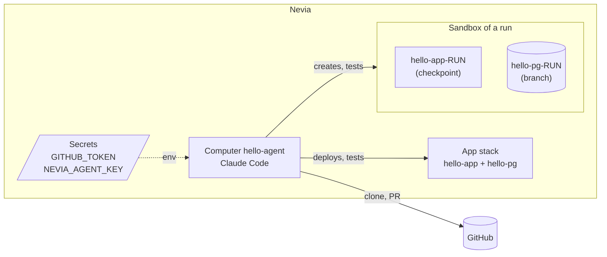
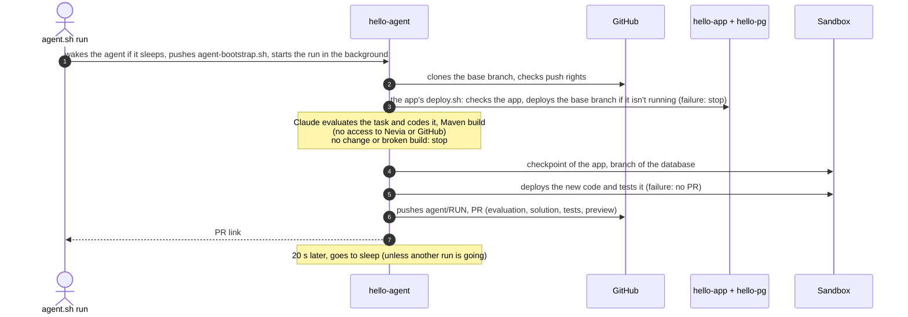

# Coding agent

A Claude Code agent, on a Nevia computer, that works on the application of a GitHub repository (e.g. [nevia-helloworld](https://github.com/bertrandcedric/nevia-helloworld)) and proposes its changes as a pull request. It never pushes to the base branch (`BASE_BRANCH`, `main` by default) and never merges: review stays human.

## Architecture



- **hello-agent**: the agent's computer, with no public port. It has its own Nevia identity: the `hello-agent` principal, role *editor*, whose key is in the `NEVIA_AGENT_KEY` secret.
- **Your machine** only creates and deletes the agent (`setup`, `destroy`). For everything else, `agent.sh` wakes `hello-agent` if it sleeps, pushes `agent-bootstrap.sh` to it with `nevia exec` and follows it: git, the build, Claude and every Nevia resource (secrets, checkpoint, branch, sandbox) are handled on the agent, which goes back to sleep once idle.
- **Sandbox**: a copy of the app (checkpoint of its computer) and of its database (branch), created after Claude's work to test the new code. It then stays running as the PR's live preview, until `cleanup`.

## Workflow of a run



The sandbox is only created if Claude produced a change that builds. If the new code fails there, the sandbox is kept for debugging.

## Code

```
agent.sh            runs on your machine: creates and deletes the agent, pushes agent-bootstrap.sh to it, follows it
agent-bootstrap.sh  runs on the agent computer: the run, ls, preview, cleanup, going to sleep
.env.example        local config (copy to .env, ignored by git)
```

The agent depends on the application only through its interface, at the root of the cloned repository:

- `deploy.sh check` and `deploy.sh deploy`: check, or deploy and check, the stack picked by `COMPUTER`, `PG_DATABASE` and `SECRET_DATABASE_URL`. The exit code tells whether the checks pass.
- `pom.xml`: the build.

Any repository with this interface can be picked at `run`; its stack is the one named by `APP_COMPUTER` and `APP_DATABASE` in `.env` (`hello-app` and `hello-pg` by default), so set them for another app. Claude can change the app's code, but not `deploy.sh` or `bootstrap.sh`.

## One-time setup

Prerequisites: the `nevia` CLI (`curl -fsSL https://get.nevia.cloud | sh`), `jq`, then `nevia login`.

1. Push the app's `main` to GitHub.
2. Create a GitHub *fine-grained* token limited to the repositories the agent works on, with *Contents* and *Pull requests* set to *Read and write*.
3. In this folder: `cp .env.example .env`, then set `NEVIA_WORKSPACE`, `GITHUB_TOKEN` and `REPO` in it.
4. `./agent.sh setup`: copies the token into the `GITHUB_TOKEN` secret, creates the agent's Nevia identity (key valid 30 days) and the `hello-agent` computer, whose env references both secrets. Run it again after changing `GITHUB_TOKEN`; `setup --rotate` renews the key.
5. Log Claude Code in once; it is already installed in the Nevia image, like the `nevia` CLI: `nevia shell hello-agent`, then `claude` and `/login`. The login stays on the computer's disk and is lost with `destroy`.

`.env` holds the minimum: `NEVIA_WORKSPACE`, `GITHUB_TOKEN` (read by `setup` only) and `REPO`, the repo `run` clones. Optional settings, in `.env` or the shell; except `AGENT` and `KEY_TTL`, they are given to the agent at each command:

| Variable | Default | Role |
|---|---|---|
| `BASE_BRANCH` | `main` | branch cloned, and base of the PRs |
| `CLAUDE_MODEL` | Claude Code's default | model used by the agent |
| `AGENT` | `hello-agent` | the agent's computer and Nevia principal |
| `KEY_TTL` | `30d` | lifetime of the agent's Nevia key (`setup`) |
| `APP_COMPUTER` | `hello-app` | the app's computer, checkpointed for each run |
| `APP_DATABASE` | `hello-pg` | the app's database, branched for each run |

## Usage

```sh
./agent.sh run                                   # default repo, asks for the task
./agent.sh run "add a GET /visits endpoint"      # default repo, task given directly
./agent.sh run --repo owner/name "..."           # another repo than REPO
./agent.sh logs [<run>]                          # follows a run, by default the latest (Ctrl-C stops following, not the run)
./agent.sh ls                                    # existing sandboxes
./agent.sh preview <run>                         # wakes a PR's sandbox if it sleeps, prints its URL
./agent.sh cleanup <run>                         # deletes the sandbox (computer, branch, secret, checkpoint)
./agent.sh down                                  # puts the agent to sleep now (unless a run is going)
./agent.sh destroy [--yes]                       # deletes the agent's computer, its secrets and its Nevia principal (sandboxes kept)
./agent.sh setup [--rotate]
./agent.sh help
```

Without a command, the script prints its help. `run` clones `REPO` (`owner/name`) from `.env` without asking; `--repo` picks another one. `run` requires a task: without an argument it asks for one (`Describe the task for the agent:`), and without a terminal it stops with an error. The more precise the task (what, where, expected behaviour), the better Claude can evaluate and implement it. A run's log is also on the agent, in `~/agent/runs/<run>.log`.

The agent goes to sleep on its own: 20 s after a run ends (time for `agent.sh` to print the end of its log), and right after `ls`, `preview`, `cleanup` or `logs`, unless a run is going. Stopping `agent.sh` (Ctrl-C, laptop closed) doesn't change that.

## Security

- Claude works on the code only: the GitHub token and the Nevia key are not passed to it (removed from its environment, key file deleted while it runs), and its only command is Maven. A `ls`, `preview` or `cleanup` started during a run writes its own key file for a few seconds. The clone, the deployments, the sandbox, the push and the PR are done by the script.
- The GitHub token only gives access to the repositories you chose for it. Protecting `main` (PR required) guarantees on GitHub's side that nothing is pushed to it directly.
- The agent's Nevia key is *editor* on the whole workspace. To fully isolate the agent, use a dedicated workspace.
