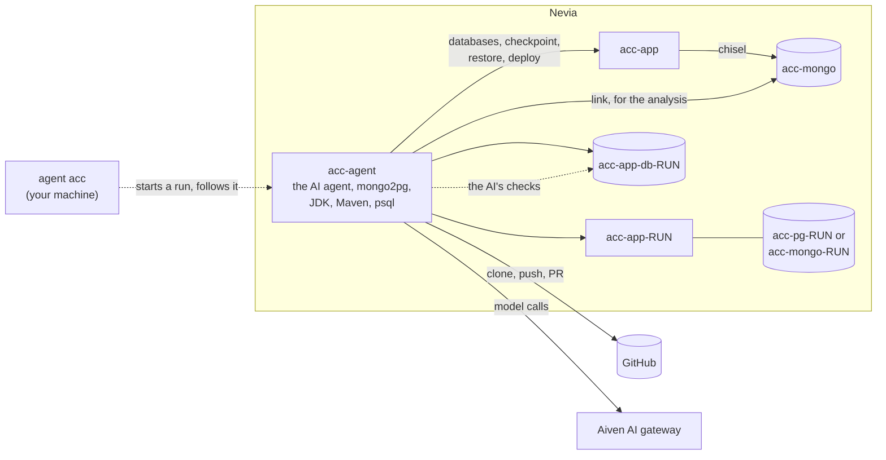
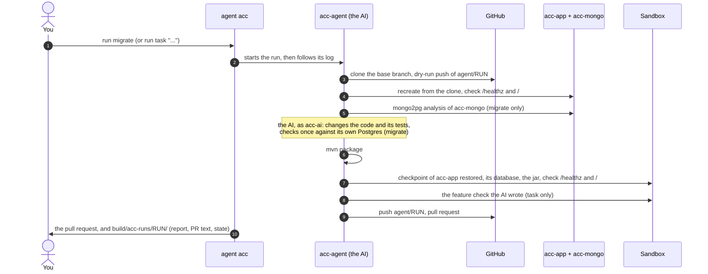

# acc: the code

An AI agent (`[ai] engine`: Claude Code, or Copilot CLI), on its own Nevia computer, changes an app and proposes the change as a pull request once a sandbox
has passed: its migration from MongoDB to Postgres (`run migrate`), or a feature you describe
(`run task "..."`, or `-f file`), e.g. for [nevia-helloworld](https://github.com/bertrandcedric/nevia-helloworld).
It never pushes to the base branch and never merges. Setup, commands and naming: [README](../README.md).

## Resources

| Name | What |
| --- | --- |
| `acc-app`, `acc-mongo` | the app's stack, made by each run from its clone of the base branch (`setup` makes none); MongoDB runs as m2p's does (the same image, in a Podman pod), with auth and the seed data, and the app reaches it through chisel |
| `acc-agent` | runs the whole run, with its key (`ACC_NEVIA_AGENT_KEY`); the AI agent, mongo2pg's binary, JDK, Maven, psql |
| `acc-ai` | the Unix user the AI runs as on `acc-agent`, with the `nevia` CLI signed in as `acc-agent-ai`, a viewer (its key file in `ACC_NEVIA_AI_KEY`, made and removed by your machine): it can't read the orchestrator's env nor its secrets, and on Nevia it can only look (no `exec`, no database connection) |
| `acc-app-RUN` | a run's sandbox: a checkpoint (`acc-RUN`) of `acc-app`; it lives until the next run's stack step, which deletes it (Nevia keeps `acc-app` while a computer restored from its checkpoint lives) |
| `acc-pg-RUN` or `acc-mongo-RUN` | its database: a new Postgres when the change moves to it, a branch of `acc-mongo` (a fork of its data) otherwise |
| `acc-app-db-RUN` | the AI's own empty Postgres for a migration, deleted once it is done |

The GitHub token (`ACC_GITHUB_TOKEN`) reaches the agent only to clone and push, the gateway key
(`ACC_AIVEN_AI_API_KEY`) only for the AI. The AI sees the structure of the data (fields, types, counts), never
its values. Settings: `[acc.*]`, and `[ai]` as m2p's; Claude Code may use `acc.agent.allowed_tools` without
asking (`nevia` included), Copilot CLI everything (either way, as `acc-ai`). Its prompts let it look at
Nevia with `nevia`, not change it, and its viewer key holds it to that: the pipeline makes and deletes the
stack, the sandbox and the databases.

With `[acc.postgres] pooler = true`, the app's `DATABASE_URL` (the stack's and the sandbox's) goes through the
database's connection pooler (port 6432 of the same host, transaction pooling), with `prepareThreshold=0` for
JDBC, which the app passes on; the seed data's psql goes through it without that parameter, and the AI's own
Postgres doesn't.

## A run

- **clone**: the base branch, and a dry-run push of `agent/RUN` to check the token first.
- **stack**: the earlier runs' sandboxes (`acc-app-RUN`, then `acc-mongo-RUN`) deleted, so the previous preview
  URL goes away; their databases and secrets stay for `clean`. Then `acc-app` and `acc-mongo` recreated from the
  clone (seed data `local/mongo-init/*.js`), never an older version.
- **analysis** (migrate): mongo2pg `init` and `infer` on `acc-agent`, through a nevia-kit link to `acc-mongo`;
  the AI gets the schemas, stats, warnings, mappings and SQL read-only, without the sample values.
- **ai**: the task is `prompts/acc/MIGRATE.md`, or `FEATURE.md` around your request. For a
  task, the AI also writes a feature check: a script that calls the new endpoints of a deployed app.
- **build**: `mvn package`, the tests included.
- **sandbox**: `acc-app-RUN`, on `acc-pg-RUN` loaded with `local/postgres-init/*.sql`, or on a fork of
  `acc-mongo`; the jar built on the agent must answer.
- **feature check** (task): the AI's script against the sandbox, with nothing but `PATH` and `HOME`.
- **pr**: the AI's text, the analysis, the validation, the feature check, the preview URL.

A step that fails stops the run with no pull request. Each step is recorded once done in the run's
`state.json` on `acc-agent`, so `run resume` takes the last run up from the step that did not finish, and
`run resume --from STEP` from an earlier one (e.g. `--from sandbox`: the sandbox again, not the AI); `run`
brings the state, the report and the pull request text back to `build/acc-runs/RUN/`.
`build/acc-runs/RUN/report.md` has the outcome, the time of each step, the AI's turns (with Claude Code, its
cost estimate at list prices) and what the run left on Nevia; `clean --run RUN` deletes that. The AI's files
have m2p's names: `result.json` and `report.md` at the root, `logs/ai-1.log`, `ai-1.jsonl` and `ai-1.json`.
