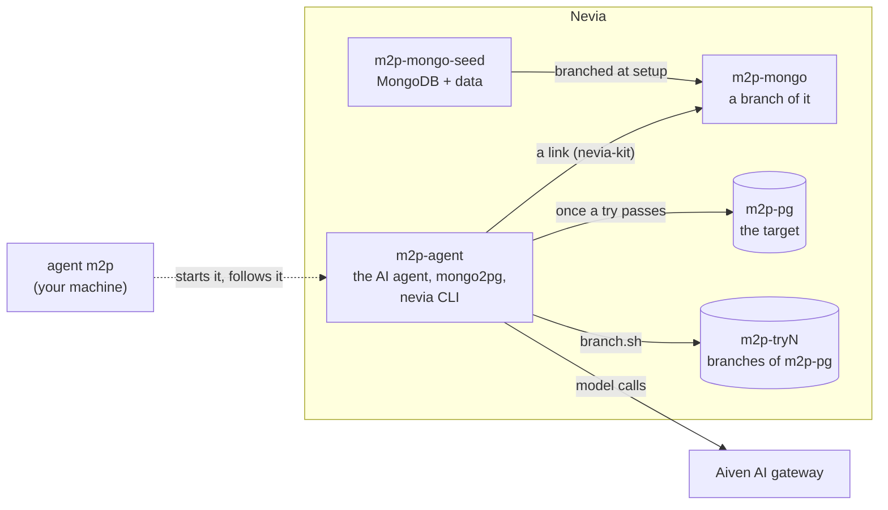
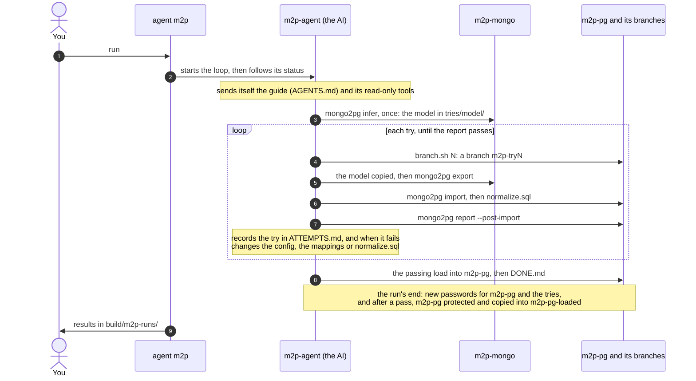

# m2p: the data

An AI agent (`[ai] engine`: Claude Code, or Copilot CLI), on its own Nevia computer, works out how to load the hello MongoDB (the customers of
[nevia-helloworld](https://github.com/bertrandcedric/nevia-helloworld)) into PostgreSQL with mongo2pg: it tries
loads on branches of the target until mongo2pg's report says the copy matches. Setup, commands and
naming: [README](../README.md).

## Resources

| Name | What |
| --- | --- |
| `m2p-mongo-seed` | MongoDB in a pod, with the data `seed.py` generates there; asleep between setups. `~/seed.json` records what it was seeded with: `[m2p.seed]`, the database, `[mongodb] image` and seed.py's sha256 |
| `m2p-mongo` | the source: a fresh branch of `m2p-mongo-seed` at each `setup`, MongoDB started there |
| `m2p-pg` | the target Postgres; its URI in `M2P_PG_URL`. Protected once a run passed |
| `m2p-pg-loaded` | a protected copy of `m2p-pg` made after a run that passed (the previous one replaced): a restore point to keep until you cut over |
| `m2p-try1`, `m2p-try2`... | a branch of `m2p-pg` per try, kept until `clean`: the agent never deletes one |
| `m2p-agent` | runs everything, with its key (`M2P_NEVIA_AGENT_KEY`): it makes `m2p-mongo` and `m2p-pg` at `setup`; the AI agent, mongo2pg's binary, the `nevia` CLI signed in with the same key, MongoDB at `127.0.0.1:27017` through a nevia-kit link |

The gateway key (`M2P_AIVEN_AI_API_KEY`) reaches only the AI's sessions. The AI may do anything on `m2p-agent`:
the computer is its own.

## A run

- The agent follows `prompts/m2p/AGENTS.md`, which gives no hints about the known issues.
- To fix a failure it fixes the data first: mongo2pg's configuration and mappings, or one SQL file,
  `tries/NAME/normalize.sql`, run after the import (never in MongoDB). It changes the SQL model mongo2pg
  inferred only when that can't pass, and uses no JSONB or JSON column.
- A load passes when mongo2pg's post-import report has the same row count and matching MD5 for every table,
  and nothing else checks it. A table `normalize.sql` converted passes on its row count: the report hashes
  MongoDB's original values.
- A run ends with `DONE.md`, after `m2p.agent.sessions` AI sessions, after `m2p.agent.hours`, or with
  `stop`. `run --details` shows every command and edit.
- A run's end, however it ended (`stop` too), resets the password of `m2p-pg` and of every try branch still
  there (`nevia pg reset-password`): every URI the AI saw, in `tries/*.uri`, its projects' configs or its
  logs, stops working. `m2p-pg`'s new one goes into `M2P_PG_URL` only (`DATABASE_URL` and `clean` read it
  there), and the `tries/m2p-tryN.uri` files are deleted; the collected results need none of them.
- After a run that passed (`DONE.md`), `m2p-pg` is protected (`nevia pg set --protected true`), and copied into
  `m2p-pg-loaded`, protected too, in place of an earlier run's copy: a restore point before the cut-over.
  Neither name is a try's (`m2p-tryN`, a number at its end), so `clean` never takes one for a try.
- `clean` empties `~/loop` (all but the guide, tools, binary and mongo2pg checkout), deletes the `m2p-try*`
  branches and drops the `hello` schema of `m2p-pg` (protection only refuses deleting it); `m2p-pg-loaded`,
  `m2p-mongo-seed` and the protection stay. `destroy` lists and deletes them all, clearing a protection first.

## Results

`run` copies them to `build/m2p-runs/<UTC time>/` when the agent stops, connection URIs scrubbed:

- `ATTEMPTS.md`, `DONE.md`, the agent's scripts, and one mongo2pg project per load with its logs and report:
  `tries/tryN/`, and `tries/final/` for `m2p-pg`
- `final.sql`: all the SQL `m2p-pg` was loaded with, in order: the DDL the final import applied, then
  `normalize.sql`
- `report.md`: the outcome, each AI session's end, turns, time and cost, and the tokens by model; `result.json`,
  the sessions' results summed (with Claude Code, `total_cost_usd`: its estimate at list prices)
- `logs/ai-N.log`: one line per thing the agent did in AI session N, its end line with the session's cost (its
  raw events in `ai-N.jsonl`, its result in `ai-N.json`), and `agent-job.log`
- `skipped.txt`: files over 20 MiB left on the computer, as are each load's CSV export, the tools and the binary

If the download fails three times, `run` again collects them.

## The data

What is specific to it is in `src/m2p/usecase/`; the rest works on any MongoDB database. One
collection, `hello.customers`: a document per customer, with addresses, contacts, orders and their items, tags
and preferences, generated by `seed.py` (a port of uc3's `seed.mjs`: the same `[m2p.seed]` give the same
documents).

`strange_kinds` adds one to three anomalies to `strange` percent of the customers: `[]` none,
`["date-string"]` some order dates as strings, `["all"]` every kind uc3 has (`seed.py --help` lists them).

`seed.py` runs on `m2p-mongo-seed`, not at every `setup`: one whose `~/seed.json` matches the settings is kept,
any other (or one whose seed stopped halfway, with no record) is deleted and made again from scratch. Then
`setup` stops its MongoDB, waits 5 s (a branch of a running computer may reuse a disk snapshot that recent),
deletes `m2p-mongo` with the agent's link to it, branches `m2p-mongo-seed` into a new `m2p-mongo`, starts
MongoDB there and puts `m2p-mongo-seed` to sleep. So every setup gives the agent the same data, a fresh seed's,
and a change to `[m2p.seed]` takes one more seed.

Nevia's Postgres has a fixed size and 20 GiB of storage: the ceiling for `customers`, since each load, with
`normalize.sql`'s staging tables, must fit in the target or a try branch.

## Known issues in mongo2pg

- Schemas come from a sample: columns get `NOT NULL` and `VARCHAR(n)` limits that the full data breaks.
- String `_id`s that look like ObjectIds become UUIDs, and so do ObjectId `_id`s next to string ones.
- `report --post-import` (0.8.0) finds no table when the target database is not named after the namespace:
  `m2p.mongo.database` names both.
