<!--
A 10-slide deck, plus two animated diagrams: one `---` per slide (Marp, or any Markdown-to-slides tool), the
speaker's notes in HTML comments under each slide. Diagrams are Mermaid: render them to images if the tool doesn't.

Animated diagrams: the slides whose comment reads "animation: m2p, frame N/6" (after slide 6) and
"animation: acc, frame N/7" (after slide 7) are the frames of one animation each. In Marp they are
consecutive slides, a click apart. For PowerPoint, make each animation ONE slide: the diagram of its last frame,
with each element appearing (Fade, on click) at the frame where it is first red, and the caption of that frame
replacing the previous one. The styles: red (`now`) is the step the frame shows, blue (`done`) the steps before,
grey (`todo`) the ones still to come (hidden until their click). The layout is the same in every frame.
-->

# From MongoDB to PostgreSQL

### A path for the migration, with two AI agents on Nevia

- **Nevia** gives them computers, databases and branches to work on
- **m2p** moves the data, **acc** moves the code
- You review the evidence, and decide

<!--
The promise: a migration that is evidence-driven at every step, where the agents do the tedious work on
throwaway infrastructure, and a person keeps the decisions (merge, cut over).
-->

---

# Why it is hard

- **The data has no schema**: a field is a date here, a string there; lists, nested objects, missing fields
- **The code speaks MongoDB**: the driver, BSON, queries, the local setup, the seed data
- **The API must not change**: same routes, status codes, JSON shapes, for every client
- **Proof is expensive**: a copy that "looks right" is not a copy that matches, row for row; and every try
  needs a fresh database and a copy of the app

<!--
Two halves, data and code, each with its own way to fail. And trying is costly when environments are slow to
make: that is where Nevia comes in.
-->

---

# Nevia, in five concepts

| Concept | What it is |
| --- | --- |
| **Computer** | a Linux machine in seconds, with an HTTPS URL; it sleeps when idle, wakes on demand |
| **Postgres** | a managed database, with its connection in a workspace secret |
| **Branch** | a copy of a database, or of a computer's disks, made in seconds: a fork of its data |
| **Checkpoint** | a capture of a running computer, restored as a new one: the same app, side by side |
| **Secret, key** | a workspace secret reaches a command only when it runs; a principal's key, for an agent |

All of it through one API: what a person does in the console, an agent can do too.

<!--
A workspace holds computers, databases and secrets; access is by principal and role. The CLI and the API are the
same surface, which is what makes agents possible.
-->

---

# Why Nevia helps a migration

- **Throwaway is cheap**: a branch of the target per try, a fork of MongoDB per feature, deleted after
- **The real app, beside itself**: a checkpoint restored as a sandbox, on a new Postgres, behind its own URL
- **Agents get an API, not a laptop**: their own computer, their own key, scoped to a workspace
- **Secrets stay out of reach**: templated into a command's env at run time, never in prompts or files
- **You pay for what runs**: computers sleep between runs; `clean` and `destroy` remove what is left

<!--
Each of these maps to a step of the path: branches for the data's tries, checkpoints for the code's sandbox,
secrets and keys for running agents safely.
-->

---

# The path, in five steps

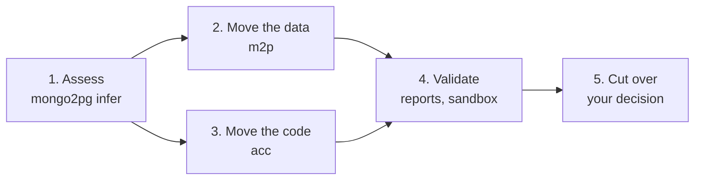

- **Assess**: mongo2pg samples MongoDB (types, presence, warnings, a proposed model); the models never see the
  values
- Steps 2 and 3 run side by side, from the same analysis; each ends with evidence

<!--
The analysis is evidence for the schema, not the schema: it saw a sample, so its NOT NULL and VARCHAR(n) are
hints to check, not rules. Its warnings become a to-do list for both agents.
-->

---

# 2. Move the data: m2p

- **The AI agent works in tries**, each on its own **branch** of the target Postgres (`m2p-tryN`)
- A try is checked by **mongo2pg's post-import report**: same row counts, matching checksums, table by table
- **Fix the data first** (mapping, configuration, one `normalize.sql`), change the model only when it must
- No JSONB shortcut; every try recorded in `ATTEMPTS.md`, every branch kept until `clean`
- The end: the target loaded, and **`final.sql`**, all the SQL it took

<!--
The loop is the point: it fails, reads the report, fixes, tries again on a fresh branch. Branches are what make
that loop cheap enough to run unattended.
-->

---

<!-- animation: m2p, frame 1/6 -->

# m2p, step by step: 1/6

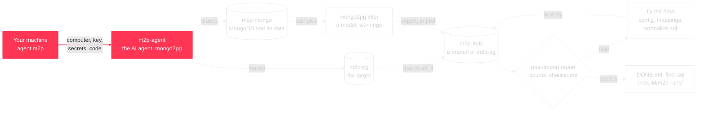

**Your machine makes the agent computer.** Its own Nevia key, the secrets from `.env`, this code: nothing else is made from your machine.

---

<!-- animation: m2p, frame 2/6 -->

# m2p, step by step: 2/6

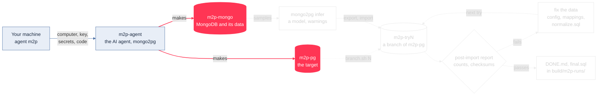

**The agent makes the source and the target.** MongoDB on `m2p-mongo`, seeded with the data, and an empty Postgres, `m2p-pg`.

---

<!-- animation: m2p, frame 3/6 -->

# m2p, step by step: 3/6

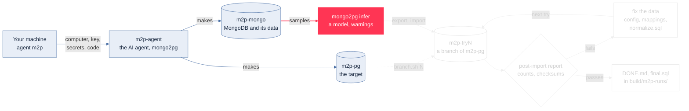

**The AI analyses the data.** mongo2pg samples MongoDB: types, presence, warnings, a proposed SQL model.

---

<!-- animation: m2p, frame 4/6 -->

# m2p, step by step: 4/6

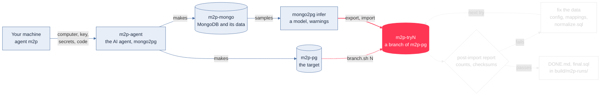

**A try, on its own branch.** Each try gets `m2p-tryN`, a branch of the target made in seconds: export from MongoDB, import there.

---

<!-- animation: m2p, frame 5/6 -->

# m2p, step by step: 5/6

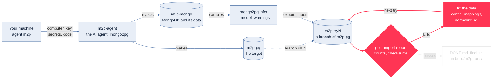

**Checked, fixed, tried again.** mongo2pg's post-import report compares every table; when it fails, the AI fixes the data and tries again on a new branch. Every branch stays, as evidence.

---

<!-- animation: m2p, frame 6/6 -->

# m2p, step by step: 6/6

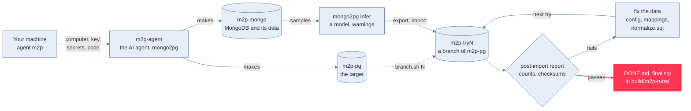

**Done.** The passing load goes into `m2p-pg`; `run` collects DONE.md, the tries and `final.sql`, all the SQL it took.

---

# 3. Move the code: acc

- **The AI agent rewrites the app**: JDBC instead of the driver, normalized tables, transactions
- **The API stays as it is**: routes, status codes, JSON shapes, validation, the UI
- The seed data moves too: `local/mongo-init/*.js` becomes `local/postgres-init/*.sql`
- It checks its work against **a Postgres of its own**, made for the run, then `mvn package` with the tests
- **No trace of MongoDB left**: a search for mongo, bson, chisel must come back empty

<!--
acc also builds any feature you describe ("run task"), tested the same way on a fork of the data: the same
pipeline serves the migration and the product work around it.
-->

---

<!-- animation: acc, frame 1/7 -->

# acc, step by step: 1/7

```mermaid
flowchart LR
    you["Your machine<br/>agent acc"]
    agent["acc-agent<br/>runs the run"]
    gh[("GitHub<br/>the app's repository")]
    app["acc-app<br/>the app, from main"]
    mongo[("acc-mongo<br/>its MongoDB, seeded")]
    infer["mongo2pg infer<br/>without the values"]
    ai["the AI, as acc-ai<br/>changes code and tests"]
    dev[("acc-app-db-RUN<br/>its own Postgres")]
    build["mvn package<br/>with the tests"]
    sb["acc-app-RUN<br/>sandbox, from a checkpoint"]
    sbdb[("acc-pg-RUN<br/>with the seed data")]
    pr["pull request<br/>agent/RUN"]
    you -->|"computer, key,<br/>secrets, code"| agent
    gh -->|"clone"| agent
    agent -->|"recreates"| app
    app -.->|"chisel"| mongo
    mongo -->|"samples"| infer
    infer -->|"schemas, read-only"| ai
    ai -.->|"checks"| dev
    ai -->|"the change"| build
    app -->|"checkpoint"| sb
    build -->|"the jar"| sb
    sb --- sbdb
    sb -->|"/healthz and / answer"| pr
    pr -->|"opened, never merged"| gh
    classDef now fill:#ff3554,stroke:#ff3554,color:#fff,stroke-width:2px
    classDef done fill:#e8eef7,stroke:#4a6fa5,color:#1b2a41
    classDef todo fill:#fff,stroke:#e6e6e6,color:#d0d0d0
    class you,agent now
    class gh,app,mongo,infer,ai,dev,build,sb,sbdb,pr todo
    linkStyle 0 stroke:#ff3554,stroke-width:2px
    linkStyle 1 stroke:#eeeeee,color:#d0d0d0
    linkStyle 2 stroke:#eeeeee,color:#d0d0d0
    linkStyle 3 stroke:#eeeeee,color:#d0d0d0
    linkStyle 4 stroke:#eeeeee,color:#d0d0d0
    linkStyle 5 stroke:#eeeeee,color:#d0d0d0
    linkStyle 6 stroke:#eeeeee,color:#d0d0d0
    linkStyle 7 stroke:#eeeeee,color:#d0d0d0
    linkStyle 8 stroke:#eeeeee,color:#d0d0d0
    linkStyle 9 stroke:#eeeeee,color:#d0d0d0
    linkStyle 10 stroke:#eeeeee,color:#d0d0d0
    linkStyle 11 stroke:#eeeeee,color:#d0d0d0
    linkStyle 12 stroke:#eeeeee,color:#d0d0d0
```

**Your machine makes the agent computer.** Its own Nevia key, the secrets from `.env`, this code; the agent does the rest.

---

<!-- animation: acc, frame 2/7 -->

# acc, step by step: 2/7

```mermaid
flowchart LR
    you["Your machine<br/>agent acc"]
    agent["acc-agent<br/>runs the run"]
    gh[("GitHub<br/>the app's repository")]
    app["acc-app<br/>the app, from main"]
    mongo[("acc-mongo<br/>its MongoDB, seeded")]
    infer["mongo2pg infer<br/>without the values"]
    ai["the AI, as acc-ai<br/>changes code and tests"]
    dev[("acc-app-db-RUN<br/>its own Postgres")]
    build["mvn package<br/>with the tests"]
    sb["acc-app-RUN<br/>sandbox, from a checkpoint"]
    sbdb[("acc-pg-RUN<br/>with the seed data")]
    pr["pull request<br/>agent/RUN"]
    you -->|"computer, key,<br/>secrets, code"| agent
    gh -->|"clone"| agent
    agent -->|"recreates"| app
    app -.->|"chisel"| mongo
    mongo -->|"samples"| infer
    infer -->|"schemas, read-only"| ai
    ai -.->|"checks"| dev
    ai -->|"the change"| build
    app -->|"checkpoint"| sb
    build -->|"the jar"| sb
    sb --- sbdb
    sb -->|"/healthz and / answer"| pr
    pr -->|"opened, never merged"| gh
    classDef now fill:#ff3554,stroke:#ff3554,color:#fff,stroke-width:2px
    classDef done fill:#e8eef7,stroke:#4a6fa5,color:#1b2a41
    classDef todo fill:#fff,stroke:#e6e6e6,color:#d0d0d0
    class gh,app,mongo now
    class you,agent done
    class infer,ai,dev,build,sb,sbdb,pr todo
    linkStyle 0 stroke:#4a6fa5
    linkStyle 1 stroke:#ff3554,stroke-width:2px
    linkStyle 2 stroke:#ff3554,stroke-width:2px
    linkStyle 3 stroke:#ff3554,stroke-width:2px
    linkStyle 4 stroke:#eeeeee,color:#d0d0d0
    linkStyle 5 stroke:#eeeeee,color:#d0d0d0
    linkStyle 6 stroke:#eeeeee,color:#d0d0d0
    linkStyle 7 stroke:#eeeeee,color:#d0d0d0
    linkStyle 8 stroke:#eeeeee,color:#d0d0d0
    linkStyle 9 stroke:#eeeeee,color:#d0d0d0
    linkStyle 10 stroke:#eeeeee,color:#d0d0d0
    linkStyle 11 stroke:#eeeeee,color:#d0d0d0
    linkStyle 12 stroke:#eeeeee,color:#d0d0d0
```

**A fresh stack, from the base branch.** The agent clones the app and recreates `acc-app` and `acc-mongo` from it: never an older version.

---

<!-- animation: acc, frame 3/7 -->

# acc, step by step: 3/7

```mermaid
flowchart LR
    you["Your machine<br/>agent acc"]
    agent["acc-agent<br/>runs the run"]
    gh[("GitHub<br/>the app's repository")]
    app["acc-app<br/>the app, from main"]
    mongo[("acc-mongo<br/>its MongoDB, seeded")]
    infer["mongo2pg infer<br/>without the values"]
    ai["the AI, as acc-ai<br/>changes code and tests"]
    dev[("acc-app-db-RUN<br/>its own Postgres")]
    build["mvn package<br/>with the tests"]
    sb["acc-app-RUN<br/>sandbox, from a checkpoint"]
    sbdb[("acc-pg-RUN<br/>with the seed data")]
    pr["pull request<br/>agent/RUN"]
    you -->|"computer, key,<br/>secrets, code"| agent
    gh -->|"clone"| agent
    agent -->|"recreates"| app
    app -.->|"chisel"| mongo
    mongo -->|"samples"| infer
    infer -->|"schemas, read-only"| ai
    ai -.->|"checks"| dev
    ai -->|"the change"| build
    app -->|"checkpoint"| sb
    build -->|"the jar"| sb
    sb --- sbdb
    sb -->|"/healthz and / answer"| pr
    pr -->|"opened, never merged"| gh
    classDef now fill:#ff3554,stroke:#ff3554,color:#fff,stroke-width:2px
    classDef done fill:#e8eef7,stroke:#4a6fa5,color:#1b2a41
    classDef todo fill:#fff,stroke:#e6e6e6,color:#d0d0d0
    class infer now
    class you,agent,gh,app,mongo done
    class ai,dev,build,sb,sbdb,pr todo
    linkStyle 0 stroke:#4a6fa5
    linkStyle 1 stroke:#4a6fa5
    linkStyle 2 stroke:#4a6fa5
    linkStyle 3 stroke:#4a6fa5
    linkStyle 4 stroke:#ff3554,stroke-width:2px
    linkStyle 5 stroke:#eeeeee,color:#d0d0d0
    linkStyle 6 stroke:#eeeeee,color:#d0d0d0
    linkStyle 7 stroke:#eeeeee,color:#d0d0d0
    linkStyle 8 stroke:#eeeeee,color:#d0d0d0
    linkStyle 9 stroke:#eeeeee,color:#d0d0d0
    linkStyle 10 stroke:#eeeeee,color:#d0d0d0
    linkStyle 11 stroke:#eeeeee,color:#d0d0d0
    linkStyle 12 stroke:#eeeeee,color:#d0d0d0
```

**The AI sees the structure, not the values.** mongo2pg infers the schemas from `acc-mongo`; the sample values are stripped before the AI reads them.

---

<!-- animation: acc, frame 4/7 -->

# acc, step by step: 4/7

```mermaid
flowchart LR
    you["Your machine<br/>agent acc"]
    agent["acc-agent<br/>runs the run"]
    gh[("GitHub<br/>the app's repository")]
    app["acc-app<br/>the app, from main"]
    mongo[("acc-mongo<br/>its MongoDB, seeded")]
    infer["mongo2pg infer<br/>without the values"]
    ai["the AI, as acc-ai<br/>changes code and tests"]
    dev[("acc-app-db-RUN<br/>its own Postgres")]
    build["mvn package<br/>with the tests"]
    sb["acc-app-RUN<br/>sandbox, from a checkpoint"]
    sbdb[("acc-pg-RUN<br/>with the seed data")]
    pr["pull request<br/>agent/RUN"]
    you -->|"computer, key,<br/>secrets, code"| agent
    gh -->|"clone"| agent
    agent -->|"recreates"| app
    app -.->|"chisel"| mongo
    mongo -->|"samples"| infer
    infer -->|"schemas, read-only"| ai
    ai -.->|"checks"| dev
    ai -->|"the change"| build
    app -->|"checkpoint"| sb
    build -->|"the jar"| sb
    sb --- sbdb
    sb -->|"/healthz and / answer"| pr
    pr -->|"opened, never merged"| gh
    classDef now fill:#ff3554,stroke:#ff3554,color:#fff,stroke-width:2px
    classDef done fill:#e8eef7,stroke:#4a6fa5,color:#1b2a41
    classDef todo fill:#fff,stroke:#e6e6e6,color:#d0d0d0
    class ai,dev now
    class you,agent,gh,app,mongo,infer done
    class build,sb,sbdb,pr todo
    linkStyle 0 stroke:#4a6fa5
    linkStyle 1 stroke:#4a6fa5
    linkStyle 2 stroke:#4a6fa5
    linkStyle 3 stroke:#4a6fa5
    linkStyle 4 stroke:#4a6fa5
    linkStyle 5 stroke:#ff3554,stroke-width:2px
    linkStyle 6 stroke:#ff3554,stroke-width:2px
    linkStyle 7 stroke:#eeeeee,color:#d0d0d0
    linkStyle 8 stroke:#eeeeee,color:#d0d0d0
    linkStyle 9 stroke:#eeeeee,color:#d0d0d0
    linkStyle 10 stroke:#eeeeee,color:#d0d0d0
    linkStyle 11 stroke:#eeeeee,color:#d0d0d0
    linkStyle 12 stroke:#eeeeee,color:#d0d0d0
```

**The AI changes the app.** As its own Unix user, with the `nevia` CLI to look around: JDBC instead of the driver, the seed data as SQL; it checks against a Postgres of its own.

---

<!-- animation: acc, frame 5/7 -->

# acc, step by step: 5/7

```mermaid
flowchart LR
    you["Your machine<br/>agent acc"]
    agent["acc-agent<br/>runs the run"]
    gh[("GitHub<br/>the app's repository")]
    app["acc-app<br/>the app, from main"]
    mongo[("acc-mongo<br/>its MongoDB, seeded")]
    infer["mongo2pg infer<br/>without the values"]
    ai["the AI, as acc-ai<br/>changes code and tests"]
    dev[("acc-app-db-RUN<br/>its own Postgres")]
    build["mvn package<br/>with the tests"]
    sb["acc-app-RUN<br/>sandbox, from a checkpoint"]
    sbdb[("acc-pg-RUN<br/>with the seed data")]
    pr["pull request<br/>agent/RUN"]
    you -->|"computer, key,<br/>secrets, code"| agent
    gh -->|"clone"| agent
    agent -->|"recreates"| app
    app -.->|"chisel"| mongo
    mongo -->|"samples"| infer
    infer -->|"schemas, read-only"| ai
    ai -.->|"checks"| dev
    ai -->|"the change"| build
    app -->|"checkpoint"| sb
    build -->|"the jar"| sb
    sb --- sbdb
    sb -->|"/healthz and / answer"| pr
    pr -->|"opened, never merged"| gh
    classDef now fill:#ff3554,stroke:#ff3554,color:#fff,stroke-width:2px
    classDef done fill:#e8eef7,stroke:#4a6fa5,color:#1b2a41
    classDef todo fill:#fff,stroke:#e6e6e6,color:#d0d0d0
    class build now
    class you,agent,gh,app,mongo,infer,ai,dev done
    class sb,sbdb,pr todo
    linkStyle 0 stroke:#4a6fa5
    linkStyle 1 stroke:#4a6fa5
    linkStyle 2 stroke:#4a6fa5
    linkStyle 3 stroke:#4a6fa5
    linkStyle 4 stroke:#4a6fa5
    linkStyle 5 stroke:#4a6fa5
    linkStyle 6 stroke:#4a6fa5
    linkStyle 7 stroke:#ff3554,stroke-width:2px
    linkStyle 8 stroke:#eeeeee,color:#d0d0d0
    linkStyle 9 stroke:#eeeeee,color:#d0d0d0
    linkStyle 10 stroke:#eeeeee,color:#d0d0d0
    linkStyle 11 stroke:#eeeeee,color:#d0d0d0
    linkStyle 12 stroke:#eeeeee,color:#d0d0d0
```

**Built and tested.** `mvn package`, the tests included, on the agent computer.

---

<!-- animation: acc, frame 6/7 -->

# acc, step by step: 6/7

```mermaid
flowchart LR
    you["Your machine<br/>agent acc"]
    agent["acc-agent<br/>runs the run"]
    gh[("GitHub<br/>the app's repository")]
    app["acc-app<br/>the app, from main"]
    mongo[("acc-mongo<br/>its MongoDB, seeded")]
    infer["mongo2pg infer<br/>without the values"]
    ai["the AI, as acc-ai<br/>changes code and tests"]
    dev[("acc-app-db-RUN<br/>its own Postgres")]
    build["mvn package<br/>with the tests"]
    sb["acc-app-RUN<br/>sandbox, from a checkpoint"]
    sbdb[("acc-pg-RUN<br/>with the seed data")]
    pr["pull request<br/>agent/RUN"]
    you -->|"computer, key,<br/>secrets, code"| agent
    gh -->|"clone"| agent
    agent -->|"recreates"| app
    app -.->|"chisel"| mongo
    mongo -->|"samples"| infer
    infer -->|"schemas, read-only"| ai
    ai -.->|"checks"| dev
    ai -->|"the change"| build
    app -->|"checkpoint"| sb
    build -->|"the jar"| sb
    sb --- sbdb
    sb -->|"/healthz and / answer"| pr
    pr -->|"opened, never merged"| gh
    classDef now fill:#ff3554,stroke:#ff3554,color:#fff,stroke-width:2px
    classDef done fill:#e8eef7,stroke:#4a6fa5,color:#1b2a41
    classDef todo fill:#fff,stroke:#e6e6e6,color:#d0d0d0
    class sb,sbdb now
    class you,agent,gh,app,mongo,infer,ai,dev,build done
    class pr todo
    linkStyle 0 stroke:#4a6fa5
    linkStyle 1 stroke:#4a6fa5
    linkStyle 2 stroke:#4a6fa5
    linkStyle 3 stroke:#4a6fa5
    linkStyle 4 stroke:#4a6fa5
    linkStyle 5 stroke:#4a6fa5
    linkStyle 6 stroke:#4a6fa5
    linkStyle 7 stroke:#4a6fa5
    linkStyle 8 stroke:#ff3554,stroke-width:2px
    linkStyle 9 stroke:#ff3554,stroke-width:2px
    linkStyle 10 stroke:#ff3554,stroke-width:2px
    linkStyle 11 stroke:#eeeeee,color:#d0d0d0
    linkStyle 12 stroke:#eeeeee,color:#d0d0d0
```

**A sandbox, beside the app.** A checkpoint of `acc-app` restored as `acc-app-RUN`, on a new Postgres with the seed data; the new jar must answer.

---

<!-- animation: acc, frame 7/7 -->

# acc, step by step: 7/7

```mermaid
flowchart LR
    you["Your machine<br/>agent acc"]
    agent["acc-agent<br/>runs the run"]
    gh[("GitHub<br/>the app's repository")]
    app["acc-app<br/>the app, from main"]
    mongo[("acc-mongo<br/>its MongoDB, seeded")]
    infer["mongo2pg infer<br/>without the values"]
    ai["the AI, as acc-ai<br/>changes code and tests"]
    dev[("acc-app-db-RUN<br/>its own Postgres")]
    build["mvn package<br/>with the tests"]
    sb["acc-app-RUN<br/>sandbox, from a checkpoint"]
    sbdb[("acc-pg-RUN<br/>with the seed data")]
    pr["pull request<br/>agent/RUN"]
    you -->|"computer, key,<br/>secrets, code"| agent
    gh -->|"clone"| agent
    agent -->|"recreates"| app
    app -.->|"chisel"| mongo
    mongo -->|"samples"| infer
    infer -->|"schemas, read-only"| ai
    ai -.->|"checks"| dev
    ai -->|"the change"| build
    app -->|"checkpoint"| sb
    build -->|"the jar"| sb
    sb --- sbdb
    sb -->|"/healthz and / answer"| pr
    pr -->|"opened, never merged"| gh
    classDef now fill:#ff3554,stroke:#ff3554,color:#fff,stroke-width:2px
    classDef done fill:#e8eef7,stroke:#4a6fa5,color:#1b2a41
    classDef todo fill:#fff,stroke:#e6e6e6,color:#d0d0d0
    class pr now
    class you,agent,gh,app,mongo,infer,ai,dev,build,sb,sbdb done
    linkStyle 0 stroke:#4a6fa5
    linkStyle 1 stroke:#4a6fa5
    linkStyle 2 stroke:#4a6fa5
    linkStyle 3 stroke:#4a6fa5
    linkStyle 4 stroke:#4a6fa5
    linkStyle 5 stroke:#4a6fa5
    linkStyle 6 stroke:#4a6fa5
    linkStyle 7 stroke:#4a6fa5
    linkStyle 8 stroke:#4a6fa5
    linkStyle 9 stroke:#4a6fa5
    linkStyle 10 stroke:#4a6fa5
    linkStyle 11 stroke:#ff3554,stroke-width:2px
    linkStyle 12 stroke:#ff3554,stroke-width:2px
```

**Only then, a pull request.** What changed, the analysis, the validation, a preview URL. You review and merge.

---

# 4. Validate, 5. cut over

- **A sandbox**: a **checkpoint** of the running app restored beside it, on a new Postgres with the seed data;
  the agent's jar must answer `/healthz` and `/`, and for a feature, its own check script
- **Only then a pull request**: what changed, the analysis, the validation, a preview URL
- **Cut over is yours**: merge, load the target with `final.sql`, switch the app's database
- **Roll back** by pointing the app back: MongoDB was never touched, nothing migrated in place

<!--
The agents never merge and never cut over. They hand over artefacts (a PR, a SQL file, reports) that a team can
review with its usual tools.
-->

---

# How it runs

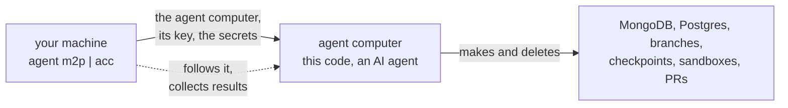

- **Your machine** only makes the agent computer; the agent does the rest, with its own Nevia key
- **Claude Code or Copilot CLI**, one setting; models through the Aiven AI gateway; both drive Nevia
  with the `nevia` CLI, the AI included, signed in with the agent's key
- **One workspace, two agents**: every name carries its agent (`m2p-…`, `acc-…`), and only those are deleted

<!--
Close the loop on the concepts: computers, branches, checkpoints and secrets, each used for what it is good at.
-->

---

# What you get, and what is next

- **Artefacts**: the loaded target, `final.sql`, post-import reports, a tested pull request, a run report with
  times, all collected in `build/`
- **Known limits**: inferred limits from samples, ObjectId-like ids, a few mongo2pg report quirks
- **Next**: more apps and data sets, the cut-over itself as a step, the Nevia cost per migration in the report
- **Try it**: `agent m2p setup && agent m2p run`, `agent acc setup && agent acc run migrate`

<!--
The whole path is reproducible, run after run, in a dedicated Nevia workspace.
-->
