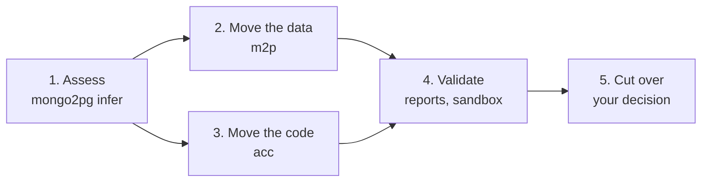
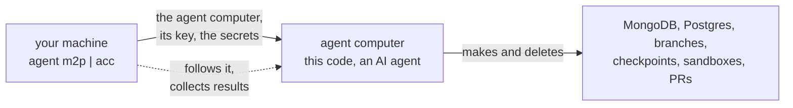

<!--
A 10-slide deck: one `---` per slide (Marp, or any Markdown-to-slides tool), the speaker's notes in HTML comments
under each slide. Diagrams are Mermaid: render them to images if the tool doesn't.
-->

# From MongoDB to PostgreSQL

### A path for the migration, with two AI agents on Nevia

- **Nevia** gives them computers, databases and branches to work on
- **m2p** moves the data, **acc** moves the code
- You review the evidence, and decide

<!--
The promise: a migration that is evidence-driven at every step, where the agents do the tedious work on
throwaway infrastructure, and a person keeps the decisions (merge, cut over).
-->

---

# Why it is hard

- **The data has no schema**: a field is a date here, a string there; lists, nested objects, missing fields
- **The code speaks MongoDB**: the driver, BSON, queries, the local setup, the seed data
- **The API must not change**: same routes, status codes, JSON shapes, for every client
- **Proof is expensive**: a copy that "looks right" is not a copy that matches, row for row; and every try
  needs a fresh database and a copy of the app

<!--
Two halves, data and code, each with its own way to fail. And trying is costly when environments are slow to
make: that is where Nevia comes in.
-->

---

# Nevia, in five concepts

| Concept | What it is |
| --- | --- |
| **Computer** | a Linux machine in seconds, with an HTTPS URL; it sleeps when idle, wakes on demand |
| **Postgres** | a managed database, with its connection in a workspace secret |
| **Branch** | a copy of a database, or of a computer's disks, made in seconds: a fork of its data |
| **Checkpoint** | a capture of a running computer, restored as a new one: the same app, side by side |
| **Secret, key** | a workspace secret reaches a command only when it runs; a principal's key, for an agent |

All of it through one API: what a person does in the console, an agent can do too.

<!--
A workspace holds computers, databases and secrets; access is by principal and role. The CLI and the API are the
same surface, which is what makes agents possible.
-->

---

# Why Nevia helps a migration

- **Throwaway is cheap**: a branch of the target per try, a fork of MongoDB per feature, deleted after
- **The real app, beside itself**: a checkpoint restored as a sandbox, on a new Postgres, behind its own URL
- **Agents get an API, not a laptop**: their own computer, their own key, scoped to a workspace
- **Secrets stay out of reach**: templated into a command's env at run time, never in prompts or files
- **You pay for what runs**: computers sleep between runs; `clean` and `destroy` remove what is left

<!--
Each of these maps to a step of the path: branches for the data's tries, checkpoints for the code's sandbox,
secrets and keys for running agents safely.
-->

---

# The path, in five steps

- **Assess**: mongo2pg samples MongoDB (types, presence, warnings, a proposed model); the models never see the
  values
- Steps 2 and 3 run side by side, from the same analysis; each ends with evidence

<!--
The analysis is evidence for the schema, not the schema: it saw a sample, so its NOT NULL and VARCHAR(n) are
hints to check, not rules. Its warnings become a to-do list for both agents.
-->

---

# 2. Move the data: m2p

- **Copilot works in tries**, each on its own **branch** of the target Postgres (`m2p-tryN`)
- A try is checked by **mongo2pg's post-import report**: same row counts, matching checksums, table by table
- **Fix the data first** (mapping, configuration, one `normalize.sql`), change the model only when it must
- No JSONB shortcut; every try recorded in `ATTEMPTS.md`, every branch kept until `clean`
- The end: the target loaded, and **`final.sql`**, all the SQL it took

<!--
The loop is the point: it fails, reads the report, fixes, tries again on a fresh branch. Branches are what make
that loop cheap enough to run unattended.
-->

---

# 3. Move the code: acc

- **Claude Code rewrites the app**: JDBC instead of the driver, normalized tables, transactions
- **The API stays as it is**: routes, status codes, JSON shapes, validation, the UI
- The seed data moves too: `local/mongo-init/*.js` becomes `local/postgres-init/*.sql`
- It checks its work against **a Postgres of its own**, made for the run, then `mvn package` with the tests
- **No trace of MongoDB left**: a search for mongo, bson, chisel must come back empty

<!--
acc also builds any feature you describe ("run task"), tested the same way on a fork of the data: the same
pipeline serves the migration and the product work around it.
-->

---

# 4. Validate, 5. cut over

- **A sandbox**: a **checkpoint** of the running app restored beside it, on a new Postgres with the seed data;
  the agent's jar must answer `/healthz` and `/`, and for a feature, Claude's own check script
- **Only then a pull request**: what changed, the analysis, the validation, a preview URL
- **Cut over is yours**: merge, load the target with `final.sql`, switch the app's database
- **Roll back** by pointing the app back: MongoDB was never touched, nothing migrated in place

<!--
The agents never merge and never cut over. They hand over artefacts (a PR, a SQL file, reports) that a team can
review with its usual tools.
-->

---

# How it runs

- **Your machine** only makes the agent computer; the agent does the rest, with its own Nevia key
- **Models** through the Aiven AI gateway; **Claude** as its own Unix user, without the key
- **One workspace, two agents**: every name carries its agent (`m2p-…`, `acc-…`), and only those are deleted

<!--
Close the loop on the concepts: computers, branches, checkpoints and secrets, each used for what it is good at.
-->

---

# What you get, and what is next

- **Artefacts**: the loaded target, `final.sql`, post-import reports, a tested pull request, a run report with
  times and AI costs, all collected in `build/`
- **Known limits**: inferred limits from samples, ObjectId-like ids, a few mongo2pg report quirks
- **Next**: more apps and data sets, the cut-over itself as a step, the Nevia cost per migration in the report
- **Try it**: `agent m2p setup && agent m2p run`, `agent acc setup && agent acc run migrate`

<!--
The whole path is reproducible, run after run, in a dedicated Nevia workspace.
-->
