<!--
A 10-slide deck, plus two animated diagrams: one `---` per slide (Marp, or any Markdown-to-slides tool), the
speaker's notes in HTML comments under each slide. Diagrams are Mermaid: render them to images if the tool doesn't;
the migration's triangle is an image, migration.svg.

Animated diagrams: the slides whose comment reads "animation: m2p, frame N/9" (after slide 6) and
"animation: acc, frame N/7" (after slide 7) are the frames of one animation each. In Marp they are
consecutive slides, a click apart, and so in PowerPoint too (make_pptx.py): one slide per frame, with no
transition, so that going back a step is going back a slide. A box keeps its colour, its kind's, in every frame; the step
a frame shows has its arrows in red, and what is still to come is hidden. The layout is the same in every frame.
-->

# From MongoDB to PostgreSQL

### A path for the migration, with two AI agents on Nevia

- **Nevia** gives them computers, databases and branches to work on
- **m2p** (Mongo to Postgres) moves the data, **acc** (application code changer) moves the code
- You review the evidence, and decide

<!--
The promise: a migration that is evidence-driven at every step, where the agents do the tedious work on
throwaway infrastructure, and a person keeps the decisions (merge, cut over).
-->

---

<!-- _class: text -->

# Why it is hard

- **The data has no schema**: mixed types, nested, missing fields
- **The code speaks MongoDB**: driver, queries, seed data
- **The API must not change**: same routes, same JSON
- **Proof is expensive**: every try needs a fresh database

<!--
Two halves, data and code, each with its own way to fail. And trying is costly when environments are slow to
make: that is where Nevia comes in.
-->

---

# Nevia, in five concepts

| Concept | What it is |
| --- | --- |
| **Computer** | a Linux machine in seconds, with an HTTPS URL; it sleeps when idle, wakes on demand |
| **Postgres** | a managed database, with its connection in a workspace secret |
| **Branch** | a copy of a database, or of a computer's disks, made in seconds: a fork of its data |
| **Checkpoint** | a capture of a running computer, restored as a new one: the same app, side by side |
| **Secret, key** | a workspace secret reaches a command only when it runs; a principal's key, for an agent |

All of it through one API: what a person does in the console, an agent can do too.

<!--
A workspace holds computers, databases and secrets; access is by principal and role. The CLI and the API are the
same surface, which is what makes agents possible.
-->

---

<!-- _class: text -->

# Why Nevia helps a migration

- **Throwaway is cheap**: a branch per try
- **The real app, beside itself**: a sandbox from a checkpoint
- **Agents get an API**: their own computer and key
- **Secrets stay out of reach**: never in prompts or files
- **You pay for what runs**: idle computers sleep

<!--
Each of these maps to a step of the path: branches for the data's tries, checkpoints for the code's sandbox,
secrets and keys for running agents safely.
-->

---

# The migration, in one picture

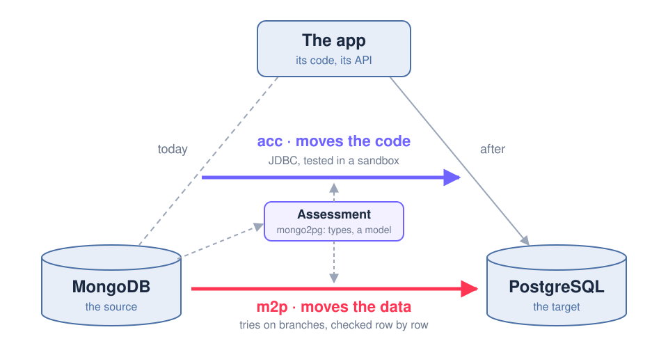

- **m2p**, Mongo to Postgres: the agent that migrates the data
- **acc**, application code changer: the agent that changes the app's code
- **mongo2pg** assesses MongoDB first: both agents start from its analysis
- **You** validate, and cut over

<!--
The analysis is evidence for the schema, not the schema: it saw a sample, so its NOT NULL and VARCHAR(n) are
hints to check, not rules. Its warnings become a to-do list for both agents.
-->

---

<!-- _class: text -->

# 2. Move the data: m2p

- **m2p, Mongo to Postgres**: an AI agent that migrates the data
- **One try, one branch** of the target Postgres
- **Checked by mongo2pg**: row counts and checksums
- **Fix the data first**, the model only if needed
- **The result**: the target loaded, and `final.sql`

<!--
The loop is the point: it fails, reads the report, fixes, tries again on a fresh branch. Branches are what make
that loop cheap enough to run unattended.
-->

---

<!-- animation: m2p, frame 1/9 -->

# m2p, step by step: 1/9

```mermaid
flowchart LR
    you["Your machine<br/>agent m2p"]
    agent["m2p-agent<br/>the AI agent, mongo2pg"]
    mongo[("m2p-mongo<br/>MongoDB and its data")]
    pg[("m2p-pg<br/>the target")]
    infer["mongo2pg infer<br/>a model, warnings"]
    t1[("m2p-try1<br/>report: fails")]
    f1["analyse, fix<br/>SQL, or the model"]
    t2[("m2p-try2<br/>report: fails")]
    f2["analyse, fix<br/>SQL, or the model"]
    t3[("m2p-try3<br/>report: passes")]
    finish["DONE.md, final.sql<br/>in build/m2p-runs/"]
    you -->|"computer, key,<br/>secrets, code"| agent
    agent -->|"makes"| mongo
    agent -->|"makes"| pg
    mongo -->|"samples"| infer
    infer -->|"export, import"| t1
    pg -.->|"branch.sh 1"| t1
    t1 -->|"the report"| f1
    f1 -->|"next try"| t2
    pg -.->|"branch.sh 2"| t2
    t2 -->|"the report"| f2
    f2 -->|"next try"| t3
    pg -.->|"branch.sh 3"| t3
    t3 -->|"passes"| finish
    finish -->|"loads"| pg
    classDef kyou fill:#fff,stroke:#1b2a41,color:#1b2a41,stroke-width:2px
    classDef kcomputer fill:#fff,stroke:#1fa5a3,color:#1b2a41,stroke-width:2px
    classDef kdb fill:#fff,stroke:#2e9e44,color:#1b2a41,stroke-width:2px
    classDef kai fill:#fff,stroke:#6f64ff,color:#1b2a41,stroke-width:2px
    classDef kresult fill:#fff,stroke:#e8833a,color:#1b2a41,stroke-width:2px
    classDef todo fill:#fff,stroke:#fff,color:#fff
    class you kyou
    class agent kcomputer
    class mongo,pg,infer,t1,f1,t2,f2,t3,finish todo
    linkStyle 0 stroke:#ff3554,stroke-width:2px
    linkStyle 1 stroke:#fff,color:#fff
    linkStyle 2 stroke:#fff,color:#fff
    linkStyle 3 stroke:#fff,color:#fff
    linkStyle 4 stroke:#fff,color:#fff
    linkStyle 5 stroke:#fff,color:#fff
    linkStyle 6 stroke:#fff,color:#fff
    linkStyle 7 stroke:#fff,color:#fff
    linkStyle 8 stroke:#fff,color:#fff
    linkStyle 9 stroke:#fff,color:#fff
    linkStyle 10 stroke:#fff,color:#fff
    linkStyle 11 stroke:#fff,color:#fff
    linkStyle 12 stroke:#fff,color:#fff
    linkStyle 13 stroke:#fff,color:#fff
```

**It starts on your machine.** You start the agent: it gets its own computer on Nevia, and does the rest from there.

---

<!-- animation: m2p, frame 2/9 -->

# m2p, step by step: 2/9

```mermaid
flowchart LR
    you["Your machine<br/>agent m2p"]
    agent["m2p-agent<br/>the AI agent, mongo2pg"]
    mongo[("m2p-mongo<br/>MongoDB and its data")]
    pg[("m2p-pg<br/>the target")]
    infer["mongo2pg infer<br/>a model, warnings"]
    t1[("m2p-try1<br/>report: fails")]
    f1["analyse, fix<br/>SQL, or the model"]
    t2[("m2p-try2<br/>report: fails")]
    f2["analyse, fix<br/>SQL, or the model"]
    t3[("m2p-try3<br/>report: passes")]
    finish["DONE.md, final.sql<br/>in build/m2p-runs/"]
    you -->|"computer, key,<br/>secrets, code"| agent
    agent -->|"makes"| mongo
    agent -->|"makes"| pg
    mongo -->|"samples"| infer
    infer -->|"export, import"| t1
    pg -.->|"branch.sh 1"| t1
    t1 -->|"the report"| f1
    f1 -->|"next try"| t2
    pg -.->|"branch.sh 2"| t2
    t2 -->|"the report"| f2
    f2 -->|"next try"| t3
    pg -.->|"branch.sh 3"| t3
    t3 -->|"passes"| finish
    finish -->|"loads"| pg
    classDef kyou fill:#fff,stroke:#1b2a41,color:#1b2a41,stroke-width:2px
    classDef kcomputer fill:#fff,stroke:#1fa5a3,color:#1b2a41,stroke-width:2px
    classDef kdb fill:#fff,stroke:#2e9e44,color:#1b2a41,stroke-width:2px
    classDef kai fill:#fff,stroke:#6f64ff,color:#1b2a41,stroke-width:2px
    classDef kresult fill:#fff,stroke:#e8833a,color:#1b2a41,stroke-width:2px
    classDef todo fill:#fff,stroke:#fff,color:#fff
    class you kyou
    class agent kcomputer
    class mongo,pg kdb
    class infer,t1,f1,t2,f2,t3,finish todo
    linkStyle 0 stroke:#9aa5b8
    linkStyle 1 stroke:#ff3554,stroke-width:2px
    linkStyle 2 stroke:#ff3554,stroke-width:2px
    linkStyle 3 stroke:#fff,color:#fff
    linkStyle 4 stroke:#fff,color:#fff
    linkStyle 5 stroke:#fff,color:#fff
    linkStyle 6 stroke:#fff,color:#fff
    linkStyle 7 stroke:#fff,color:#fff
    linkStyle 8 stroke:#fff,color:#fff
    linkStyle 9 stroke:#fff,color:#fff
    linkStyle 10 stroke:#fff,color:#fff
    linkStyle 11 stroke:#fff,color:#fff
    linkStyle 12 stroke:#fff,color:#fff
    linkStyle 13 stroke:#fff,color:#fff
```

**A source and a target.** The agent sets up MongoDB with the data to move, and an empty PostgreSQL to receive it.

---

<!-- animation: m2p, frame 3/9 -->

# m2p, step by step: 3/9

```mermaid
flowchart LR
    you["Your machine<br/>agent m2p"]
    agent["m2p-agent<br/>the AI agent, mongo2pg"]
    mongo[("m2p-mongo<br/>MongoDB and its data")]
    pg[("m2p-pg<br/>the target")]
    infer["mongo2pg infer<br/>a model, warnings"]
    t1[("m2p-try1<br/>report: fails")]
    f1["analyse, fix<br/>SQL, or the model"]
    t2[("m2p-try2<br/>report: fails")]
    f2["analyse, fix<br/>SQL, or the model"]
    t3[("m2p-try3<br/>report: passes")]
    finish["DONE.md, final.sql<br/>in build/m2p-runs/"]
    you -->|"computer, key,<br/>secrets, code"| agent
    agent -->|"makes"| mongo
    agent -->|"makes"| pg
    mongo -->|"samples"| infer
    infer -->|"export, import"| t1
    pg -.->|"branch.sh 1"| t1
    t1 -->|"the report"| f1
    f1 -->|"next try"| t2
    pg -.->|"branch.sh 2"| t2
    t2 -->|"the report"| f2
    f2 -->|"next try"| t3
    pg -.->|"branch.sh 3"| t3
    t3 -->|"passes"| finish
    finish -->|"loads"| pg
    classDef kyou fill:#fff,stroke:#1b2a41,color:#1b2a41,stroke-width:2px
    classDef kcomputer fill:#fff,stroke:#1fa5a3,color:#1b2a41,stroke-width:2px
    classDef kdb fill:#fff,stroke:#2e9e44,color:#1b2a41,stroke-width:2px
    classDef kai fill:#fff,stroke:#6f64ff,color:#1b2a41,stroke-width:2px
    classDef kresult fill:#fff,stroke:#e8833a,color:#1b2a41,stroke-width:2px
    classDef todo fill:#fff,stroke:#fff,color:#fff
    class you kyou
    class agent kcomputer
    class mongo,pg kdb
    class infer kai
    class t1,f1,t2,f2,t3,finish todo
    linkStyle 0 stroke:#9aa5b8
    linkStyle 1 stroke:#9aa5b8
    linkStyle 2 stroke:#9aa5b8
    linkStyle 3 stroke:#ff3554,stroke-width:2px
    linkStyle 4 stroke:#fff,color:#fff
    linkStyle 5 stroke:#fff,color:#fff
    linkStyle 6 stroke:#fff,color:#fff
    linkStyle 7 stroke:#fff,color:#fff
    linkStyle 8 stroke:#fff,color:#fff
    linkStyle 9 stroke:#fff,color:#fff
    linkStyle 10 stroke:#fff,color:#fff
    linkStyle 11 stroke:#fff,color:#fff
    linkStyle 12 stroke:#fff,color:#fff
    linkStyle 13 stroke:#fff,color:#fff
```

**First, understand the data.** mongo2pg looks at a sample of MongoDB, and proposes how to store it in PostgreSQL.

---

<!-- animation: m2p, frame 4/9 -->

# m2p, step by step: 4/9

```mermaid
flowchart LR
    you["Your machine<br/>agent m2p"]
    agent["m2p-agent<br/>the AI agent, mongo2pg"]
    mongo[("m2p-mongo<br/>MongoDB and its data")]
    pg[("m2p-pg<br/>the target")]
    infer["mongo2pg infer<br/>a model, warnings"]
    t1[("m2p-try1<br/>report: fails")]
    f1["analyse, fix<br/>SQL, or the model"]
    t2[("m2p-try2<br/>report: fails")]
    f2["analyse, fix<br/>SQL, or the model"]
    t3[("m2p-try3<br/>report: passes")]
    finish["DONE.md, final.sql<br/>in build/m2p-runs/"]
    you -->|"computer, key,<br/>secrets, code"| agent
    agent -->|"makes"| mongo
    agent -->|"makes"| pg
    mongo -->|"samples"| infer
    infer -->|"export, import"| t1
    pg -.->|"branch.sh 1"| t1
    t1 -->|"the report"| f1
    f1 -->|"next try"| t2
    pg -.->|"branch.sh 2"| t2
    t2 -->|"the report"| f2
    f2 -->|"next try"| t3
    pg -.->|"branch.sh 3"| t3
    t3 -->|"passes"| finish
    finish -->|"loads"| pg
    classDef kyou fill:#fff,stroke:#1b2a41,color:#1b2a41,stroke-width:2px
    classDef kcomputer fill:#fff,stroke:#1fa5a3,color:#1b2a41,stroke-width:2px
    classDef kdb fill:#fff,stroke:#2e9e44,color:#1b2a41,stroke-width:2px
    classDef kai fill:#fff,stroke:#6f64ff,color:#1b2a41,stroke-width:2px
    classDef kresult fill:#fff,stroke:#e8833a,color:#1b2a41,stroke-width:2px
    classDef todo fill:#fff,stroke:#fff,color:#fff
    class you kyou
    class agent kcomputer
    class mongo,pg,t1 kdb
    class infer kai
    class f1,t2,f2,t3,finish todo
    linkStyle 0 stroke:#9aa5b8
    linkStyle 1 stroke:#9aa5b8
    linkStyle 2 stroke:#9aa5b8
    linkStyle 3 stroke:#9aa5b8
    linkStyle 4 stroke:#ff3554,stroke-width:2px
    linkStyle 5 stroke:#ff3554,stroke-width:2px
    linkStyle 6 stroke:#fff,color:#fff
    linkStyle 7 stroke:#fff,color:#fff
    linkStyle 8 stroke:#fff,color:#fff
    linkStyle 9 stroke:#fff,color:#fff
    linkStyle 10 stroke:#fff,color:#fff
    linkStyle 11 stroke:#fff,color:#fff
    linkStyle 12 stroke:#fff,color:#fff
    linkStyle 13 stroke:#fff,color:#fff
```

**A first try, on a copy.** The data goes into a fresh copy of the target, made in seconds. The check finds differences: it fails.

---

<!-- animation: m2p, frame 5/9 -->

# m2p, step by step: 5/9

```mermaid
flowchart LR
    you["Your machine<br/>agent m2p"]
    agent["m2p-agent<br/>the AI agent, mongo2pg"]
    mongo[("m2p-mongo<br/>MongoDB and its data")]
    pg[("m2p-pg<br/>the target")]
    infer["mongo2pg infer<br/>a model, warnings"]
    t1[("m2p-try1<br/>report: fails")]
    f1["analyse, fix<br/>SQL, or the model"]
    t2[("m2p-try2<br/>report: fails")]
    f2["analyse, fix<br/>SQL, or the model"]
    t3[("m2p-try3<br/>report: passes")]
    finish["DONE.md, final.sql<br/>in build/m2p-runs/"]
    you -->|"computer, key,<br/>secrets, code"| agent
    agent -->|"makes"| mongo
    agent -->|"makes"| pg
    mongo -->|"samples"| infer
    infer -->|"export, import"| t1
    pg -.->|"branch.sh 1"| t1
    t1 -->|"the report"| f1
    f1 -->|"next try"| t2
    pg -.->|"branch.sh 2"| t2
    t2 -->|"the report"| f2
    f2 -->|"next try"| t3
    pg -.->|"branch.sh 3"| t3
    t3 -->|"passes"| finish
    finish -->|"loads"| pg
    classDef kyou fill:#fff,stroke:#1b2a41,color:#1b2a41,stroke-width:2px
    classDef kcomputer fill:#fff,stroke:#1fa5a3,color:#1b2a41,stroke-width:2px
    classDef kdb fill:#fff,stroke:#2e9e44,color:#1b2a41,stroke-width:2px
    classDef kai fill:#fff,stroke:#6f64ff,color:#1b2a41,stroke-width:2px
    classDef kresult fill:#fff,stroke:#e8833a,color:#1b2a41,stroke-width:2px
    classDef todo fill:#fff,stroke:#fff,color:#fff
    class you kyou
    class agent kcomputer
    class mongo,pg,t1 kdb
    class infer,f1 kai
    class t2,f2,t3,finish todo
    linkStyle 0 stroke:#9aa5b8
    linkStyle 1 stroke:#9aa5b8
    linkStyle 2 stroke:#9aa5b8
    linkStyle 3 stroke:#9aa5b8
    linkStyle 4 stroke:#9aa5b8
    linkStyle 5 stroke:#9aa5b8
    linkStyle 6 stroke:#ff3554,stroke-width:2px
    linkStyle 7 stroke:#fff,color:#fff
    linkStyle 8 stroke:#fff,color:#fff
    linkStyle 9 stroke:#fff,color:#fff
    linkStyle 10 stroke:#fff,color:#fff
    linkStyle 11 stroke:#fff,color:#fff
    linkStyle 12 stroke:#fff,color:#fff
    linkStyle 13 stroke:#fff,color:#fff
```

**Find out why, and fix it.** The AI reads what went wrong, and corrects how the data is converted; it changes the tables only if it must.

---

<!-- animation: m2p, frame 6/9 -->

# m2p, step by step: 6/9

```mermaid
flowchart LR
    you["Your machine<br/>agent m2p"]
    agent["m2p-agent<br/>the AI agent, mongo2pg"]
    mongo[("m2p-mongo<br/>MongoDB and its data")]
    pg[("m2p-pg<br/>the target")]
    infer["mongo2pg infer<br/>a model, warnings"]
    t1[("m2p-try1<br/>report: fails")]
    f1["analyse, fix<br/>SQL, or the model"]
    t2[("m2p-try2<br/>report: fails")]
    f2["analyse, fix<br/>SQL, or the model"]
    t3[("m2p-try3<br/>report: passes")]
    finish["DONE.md, final.sql<br/>in build/m2p-runs/"]
    you -->|"computer, key,<br/>secrets, code"| agent
    agent -->|"makes"| mongo
    agent -->|"makes"| pg
    mongo -->|"samples"| infer
    infer -->|"export, import"| t1
    pg -.->|"branch.sh 1"| t1
    t1 -->|"the report"| f1
    f1 -->|"next try"| t2
    pg -.->|"branch.sh 2"| t2
    t2 -->|"the report"| f2
    f2 -->|"next try"| t3
    pg -.->|"branch.sh 3"| t3
    t3 -->|"passes"| finish
    finish -->|"loads"| pg
    classDef kyou fill:#fff,stroke:#1b2a41,color:#1b2a41,stroke-width:2px
    classDef kcomputer fill:#fff,stroke:#1fa5a3,color:#1b2a41,stroke-width:2px
    classDef kdb fill:#fff,stroke:#2e9e44,color:#1b2a41,stroke-width:2px
    classDef kai fill:#fff,stroke:#6f64ff,color:#1b2a41,stroke-width:2px
    classDef kresult fill:#fff,stroke:#e8833a,color:#1b2a41,stroke-width:2px
    classDef todo fill:#fff,stroke:#fff,color:#fff
    class you kyou
    class agent kcomputer
    class mongo,pg,t1,t2 kdb
    class infer,f1 kai
    class f2,t3,finish todo
    linkStyle 0 stroke:#9aa5b8
    linkStyle 1 stroke:#9aa5b8
    linkStyle 2 stroke:#9aa5b8
    linkStyle 3 stroke:#9aa5b8
    linkStyle 4 stroke:#9aa5b8
    linkStyle 5 stroke:#9aa5b8
    linkStyle 6 stroke:#9aa5b8
    linkStyle 7 stroke:#ff3554,stroke-width:2px
    linkStyle 8 stroke:#ff3554,stroke-width:2px
    linkStyle 9 stroke:#fff,color:#fff
    linkStyle 10 stroke:#fff,color:#fff
    linkStyle 11 stroke:#fff,color:#fff
    linkStyle 12 stroke:#fff,color:#fff
    linkStyle 13 stroke:#fff,color:#fff
```

**A second try, on a new copy.** The fix is tried on another fresh copy. Not right yet.

---

<!-- animation: m2p, frame 7/9 -->

# m2p, step by step: 7/9

```mermaid
flowchart LR
    you["Your machine<br/>agent m2p"]
    agent["m2p-agent<br/>the AI agent, mongo2pg"]
    mongo[("m2p-mongo<br/>MongoDB and its data")]
    pg[("m2p-pg<br/>the target")]
    infer["mongo2pg infer<br/>a model, warnings"]
    t1[("m2p-try1<br/>report: fails")]
    f1["analyse, fix<br/>SQL, or the model"]
    t2[("m2p-try2<br/>report: fails")]
    f2["analyse, fix<br/>SQL, or the model"]
    t3[("m2p-try3<br/>report: passes")]
    finish["DONE.md, final.sql<br/>in build/m2p-runs/"]
    you -->|"computer, key,<br/>secrets, code"| agent
    agent -->|"makes"| mongo
    agent -->|"makes"| pg
    mongo -->|"samples"| infer
    infer -->|"export, import"| t1
    pg -.->|"branch.sh 1"| t1
    t1 -->|"the report"| f1
    f1 -->|"next try"| t2
    pg -.->|"branch.sh 2"| t2
    t2 -->|"the report"| f2
    f2 -->|"next try"| t3
    pg -.->|"branch.sh 3"| t3
    t3 -->|"passes"| finish
    finish -->|"loads"| pg
    classDef kyou fill:#fff,stroke:#1b2a41,color:#1b2a41,stroke-width:2px
    classDef kcomputer fill:#fff,stroke:#1fa5a3,color:#1b2a41,stroke-width:2px
    classDef kdb fill:#fff,stroke:#2e9e44,color:#1b2a41,stroke-width:2px
    classDef kai fill:#fff,stroke:#6f64ff,color:#1b2a41,stroke-width:2px
    classDef kresult fill:#fff,stroke:#e8833a,color:#1b2a41,stroke-width:2px
    classDef todo fill:#fff,stroke:#fff,color:#fff
    class you kyou
    class agent kcomputer
    class mongo,pg,t1,t2 kdb
    class infer,f1,f2 kai
    class t3,finish todo
    linkStyle 0 stroke:#9aa5b8
    linkStyle 1 stroke:#9aa5b8
    linkStyle 2 stroke:#9aa5b8
    linkStyle 3 stroke:#9aa5b8
    linkStyle 4 stroke:#9aa5b8
    linkStyle 5 stroke:#9aa5b8
    linkStyle 6 stroke:#9aa5b8
    linkStyle 7 stroke:#9aa5b8
    linkStyle 8 stroke:#9aa5b8
    linkStyle 9 stroke:#ff3554,stroke-width:2px
    linkStyle 10 stroke:#fff,color:#fff
    linkStyle 11 stroke:#fff,color:#fff
    linkStyle 12 stroke:#fff,color:#fff
    linkStyle 13 stroke:#fff,color:#fff
```

**Another look, another fix.** The AI finds the next problem, and corrects it.

---

<!-- animation: m2p, frame 8/9 -->

# m2p, step by step: 8/9

```mermaid
flowchart LR
    you["Your machine<br/>agent m2p"]
    agent["m2p-agent<br/>the AI agent, mongo2pg"]
    mongo[("m2p-mongo<br/>MongoDB and its data")]
    pg[("m2p-pg<br/>the target")]
    infer["mongo2pg infer<br/>a model, warnings"]
    t1[("m2p-try1<br/>report: fails")]
    f1["analyse, fix<br/>SQL, or the model"]
    t2[("m2p-try2<br/>report: fails")]
    f2["analyse, fix<br/>SQL, or the model"]
    t3[("m2p-try3<br/>report: passes")]
    finish["DONE.md, final.sql<br/>in build/m2p-runs/"]
    you -->|"computer, key,<br/>secrets, code"| agent
    agent -->|"makes"| mongo
    agent -->|"makes"| pg
    mongo -->|"samples"| infer
    infer -->|"export, import"| t1
    pg -.->|"branch.sh 1"| t1
    t1 -->|"the report"| f1
    f1 -->|"next try"| t2
    pg -.->|"branch.sh 2"| t2
    t2 -->|"the report"| f2
    f2 -->|"next try"| t3
    pg -.->|"branch.sh 3"| t3
    t3 -->|"passes"| finish
    finish -->|"loads"| pg
    classDef kyou fill:#fff,stroke:#1b2a41,color:#1b2a41,stroke-width:2px
    classDef kcomputer fill:#fff,stroke:#1fa5a3,color:#1b2a41,stroke-width:2px
    classDef kdb fill:#fff,stroke:#2e9e44,color:#1b2a41,stroke-width:2px
    classDef kai fill:#fff,stroke:#6f64ff,color:#1b2a41,stroke-width:2px
    classDef kresult fill:#fff,stroke:#e8833a,color:#1b2a41,stroke-width:2px
    classDef todo fill:#fff,stroke:#fff,color:#fff
    class you kyou
    class agent kcomputer
    class mongo,pg,t1,t2,t3 kdb
    class infer,f1,f2 kai
    class finish todo
    linkStyle 0 stroke:#9aa5b8
    linkStyle 1 stroke:#9aa5b8
    linkStyle 2 stroke:#9aa5b8
    linkStyle 3 stroke:#9aa5b8
    linkStyle 4 stroke:#9aa5b8
    linkStyle 5 stroke:#9aa5b8
    linkStyle 6 stroke:#9aa5b8
    linkStyle 7 stroke:#9aa5b8
    linkStyle 8 stroke:#9aa5b8
    linkStyle 9 stroke:#9aa5b8
    linkStyle 10 stroke:#ff3554,stroke-width:2px
    linkStyle 11 stroke:#ff3554,stroke-width:2px
    linkStyle 12 stroke:#fff,color:#fff
    linkStyle 13 stroke:#fff,color:#fff
```

**The third try passes.** Every table matches the source, row for row. Each try is kept, as proof.

---

<!-- animation: m2p, frame 9/9 -->

# m2p, step by step: 9/9

```mermaid
flowchart LR
    you["Your machine<br/>agent m2p"]
    agent["m2p-agent<br/>the AI agent, mongo2pg"]
    mongo[("m2p-mongo<br/>MongoDB and its data")]
    pg[("m2p-pg<br/>the target")]
    infer["mongo2pg infer<br/>a model, warnings"]
    t1[("m2p-try1<br/>report: fails")]
    f1["analyse, fix<br/>SQL, or the model"]
    t2[("m2p-try2<br/>report: fails")]
    f2["analyse, fix<br/>SQL, or the model"]
    t3[("m2p-try3<br/>report: passes")]
    finish["DONE.md, final.sql<br/>in build/m2p-runs/"]
    you -->|"computer, key,<br/>secrets, code"| agent
    agent -->|"makes"| mongo
    agent -->|"makes"| pg
    mongo -->|"samples"| infer
    infer -->|"export, import"| t1
    pg -.->|"branch.sh 1"| t1
    t1 -->|"the report"| f1
    f1 -->|"next try"| t2
    pg -.->|"branch.sh 2"| t2
    t2 -->|"the report"| f2
    f2 -->|"next try"| t3
    pg -.->|"branch.sh 3"| t3
    t3 -->|"passes"| finish
    finish -->|"loads"| pg
    classDef kyou fill:#fff,stroke:#1b2a41,color:#1b2a41,stroke-width:2px
    classDef kcomputer fill:#fff,stroke:#1fa5a3,color:#1b2a41,stroke-width:2px
    classDef kdb fill:#fff,stroke:#2e9e44,color:#1b2a41,stroke-width:2px
    classDef kai fill:#fff,stroke:#6f64ff,color:#1b2a41,stroke-width:2px
    classDef kresult fill:#fff,stroke:#e8833a,color:#1b2a41,stroke-width:2px
    classDef todo fill:#fff,stroke:#fff,color:#fff
    class you kyou
    class agent kcomputer
    class mongo,pg,t1,t2,t3 kdb
    class infer,f1,f2 kai
    class finish kresult
    linkStyle 0 stroke:#9aa5b8
    linkStyle 1 stroke:#9aa5b8
    linkStyle 2 stroke:#9aa5b8
    linkStyle 3 stroke:#9aa5b8
    linkStyle 4 stroke:#9aa5b8
    linkStyle 5 stroke:#9aa5b8
    linkStyle 6 stroke:#9aa5b8
    linkStyle 7 stroke:#9aa5b8
    linkStyle 8 stroke:#9aa5b8
    linkStyle 9 stroke:#9aa5b8
    linkStyle 10 stroke:#9aa5b8
    linkStyle 11 stroke:#9aa5b8
    linkStyle 12 stroke:#ff3554,stroke-width:2px
    linkStyle 13 stroke:#ff3554,stroke-width:2px
```

**Done.** The data is in PostgreSQL, and you get the report and the SQL that did it.

---

<!-- _class: text -->

# 3. Move the code: acc

- **acc, application code changer**: an AI agent that changes the app's code
- **The AI rewrites the app**: JDBC, normalized tables
- **The API stays as it is**
- **The seed data moves too**, as SQL
- **Tested** on a Postgres of its own
- **No trace of MongoDB left**

<!--
acc also builds any feature you describe ("run task"), tested the same way on a fork of the data: the same
pipeline serves the migration and the product work around it.
-->

---

<!-- animation: acc, frame 1/7 -->

# acc, step by step: 1/7

```mermaid
flowchart LR
    you["Your machine<br/>agent acc"]
    agent["acc-agent<br/>runs the run"]
    gh[("GitHub<br/>the app's repository")]
    app["acc-app<br/>the app, from main"]
    mongo[("acc-mongo<br/>its MongoDB, seeded")]
    infer["mongo2pg infer<br/>without the values"]
    ai["the AI, as acc-ai<br/>changes code and tests"]
    build["Build<br/>the app and its tests"]
    sb["acc-app-RUN<br/>sandbox, from a checkpoint"]
    sbdb[("acc-pg-RUN<br/>the AI's postgres-init")]
    pr["pull request<br/>from agent/RUN"]
    you -->|"computer, key,<br/>secrets, code"| agent
    gh -->|"clone"| agent
    agent -->|"recreates"| app
    app -.->|"chisel"| mongo
    mongo -->|"samples, through<br/>a link"| infer
    infer -->|"schemas, read-only"| ai
    gh -->|"the clone"| ai
    ai -->|"the change"| build
    app -->|"checkpoint"| sb
    build -->|"the jar"| sb
    sb --- sbdb
    sb -->|"/healthz and / answer"| pr
    pr -->|"opened, never merged"| gh
    classDef kyou fill:#fff,stroke:#1b2a41,color:#1b2a41,stroke-width:2px
    classDef kcomputer fill:#fff,stroke:#1fa5a3,color:#1b2a41,stroke-width:2px
    classDef kdb fill:#fff,stroke:#2e9e44,color:#1b2a41,stroke-width:2px
    classDef kai fill:#fff,stroke:#6f64ff,color:#1b2a41,stroke-width:2px
    classDef kresult fill:#fff,stroke:#e8833a,color:#1b2a41,stroke-width:2px
    classDef todo fill:#fff,stroke:#fff,color:#fff
    class you kyou
    class agent kcomputer
    class gh,app,mongo,infer,ai,build,sb,sbdb,pr todo
    linkStyle 0 stroke:#ff3554,stroke-width:2px
    linkStyle 1 stroke:#fff,color:#fff
    linkStyle 2 stroke:#fff,color:#fff
    linkStyle 3 stroke:#fff,color:#fff
    linkStyle 4 stroke:#fff,color:#fff
    linkStyle 5 stroke:#fff,color:#fff
    linkStyle 6 stroke:#fff,color:#fff
    linkStyle 7 stroke:#fff,color:#fff
    linkStyle 8 stroke:#fff,color:#fff
    linkStyle 9 stroke:#fff,color:#fff
    linkStyle 10 stroke:#fff,color:#fff
    linkStyle 11 stroke:#fff,color:#fff
    linkStyle 12 stroke:#fff,color:#fff
```

**It starts on your machine.** You start the agent: it gets its own computer on Nevia, and does the rest from there.

---

<!-- animation: acc, frame 2/7 -->

# acc, step by step: 2/7

```mermaid
flowchart LR
    you["Your machine<br/>agent acc"]
    agent["acc-agent<br/>runs the run"]
    gh[("GitHub<br/>the app's repository")]
    app["acc-app<br/>the app, from main"]
    mongo[("acc-mongo<br/>its MongoDB, seeded")]
    infer["mongo2pg infer<br/>without the values"]
    ai["the AI, as acc-ai<br/>changes code and tests"]
    build["Build<br/>the app and its tests"]
    sb["acc-app-RUN<br/>sandbox, from a checkpoint"]
    sbdb[("acc-pg-RUN<br/>the AI's postgres-init")]
    pr["pull request<br/>from agent/RUN"]
    you -->|"computer, key,<br/>secrets, code"| agent
    gh -->|"clone"| agent
    agent -->|"recreates"| app
    app -.->|"chisel"| mongo
    mongo -->|"samples, through<br/>a link"| infer
    infer -->|"schemas, read-only"| ai
    gh -->|"the clone"| ai
    ai -->|"the change"| build
    app -->|"checkpoint"| sb
    build -->|"the jar"| sb
    sb --- sbdb
    sb -->|"/healthz and / answer"| pr
    pr -->|"opened, never merged"| gh
    classDef kyou fill:#fff,stroke:#1b2a41,color:#1b2a41,stroke-width:2px
    classDef kcomputer fill:#fff,stroke:#1fa5a3,color:#1b2a41,stroke-width:2px
    classDef kdb fill:#fff,stroke:#2e9e44,color:#1b2a41,stroke-width:2px
    classDef kai fill:#fff,stroke:#6f64ff,color:#1b2a41,stroke-width:2px
    classDef kresult fill:#fff,stroke:#e8833a,color:#1b2a41,stroke-width:2px
    classDef todo fill:#fff,stroke:#fff,color:#fff
    class you kyou
    class agent,app kcomputer
    class gh,mongo kdb
    class infer,ai,build,sb,sbdb,pr todo
    linkStyle 0 stroke:#9aa5b8
    linkStyle 1 stroke:#ff3554,stroke-width:2px
    linkStyle 2 stroke:#ff3554,stroke-width:2px
    linkStyle 3 stroke:#ff3554,stroke-width:2px
    linkStyle 4 stroke:#fff,color:#fff
    linkStyle 5 stroke:#fff,color:#fff
    linkStyle 6 stroke:#fff,color:#fff
    linkStyle 7 stroke:#fff,color:#fff
    linkStyle 8 stroke:#fff,color:#fff
    linkStyle 9 stroke:#fff,color:#fff
    linkStyle 10 stroke:#fff,color:#fff
    linkStyle 11 stroke:#fff,color:#fff
    linkStyle 12 stroke:#fff,color:#fff
```

**A fresh copy of the app.** The agent takes the app's latest code from GitHub, and runs it with its MongoDB and sample data.

---

<!-- animation: acc, frame 3/7 -->

# acc, step by step: 3/7

```mermaid
flowchart LR
    you["Your machine<br/>agent acc"]
    agent["acc-agent<br/>runs the run"]
    gh[("GitHub<br/>the app's repository")]
    app["acc-app<br/>the app, from main"]
    mongo[("acc-mongo<br/>its MongoDB, seeded")]
    infer["mongo2pg infer<br/>without the values"]
    ai["the AI, as acc-ai<br/>changes code and tests"]
    build["Build<br/>the app and its tests"]
    sb["acc-app-RUN<br/>sandbox, from a checkpoint"]
    sbdb[("acc-pg-RUN<br/>the AI's postgres-init")]
    pr["pull request<br/>from agent/RUN"]
    you -->|"computer, key,<br/>secrets, code"| agent
    gh -->|"clone"| agent
    agent -->|"recreates"| app
    app -.->|"chisel"| mongo
    mongo -->|"samples, through<br/>a link"| infer
    infer -->|"schemas, read-only"| ai
    gh -->|"the clone"| ai
    ai -->|"the change"| build
    app -->|"checkpoint"| sb
    build -->|"the jar"| sb
    sb --- sbdb
    sb -->|"/healthz and / answer"| pr
    pr -->|"opened, never merged"| gh
    classDef kyou fill:#fff,stroke:#1b2a41,color:#1b2a41,stroke-width:2px
    classDef kcomputer fill:#fff,stroke:#1fa5a3,color:#1b2a41,stroke-width:2px
    classDef kdb fill:#fff,stroke:#2e9e44,color:#1b2a41,stroke-width:2px
    classDef kai fill:#fff,stroke:#6f64ff,color:#1b2a41,stroke-width:2px
    classDef kresult fill:#fff,stroke:#e8833a,color:#1b2a41,stroke-width:2px
    classDef todo fill:#fff,stroke:#fff,color:#fff
    class you kyou
    class agent,app kcomputer
    class gh,mongo kdb
    class infer kai
    class ai,build,sb,sbdb,pr todo
    linkStyle 0 stroke:#9aa5b8
    linkStyle 1 stroke:#9aa5b8
    linkStyle 2 stroke:#9aa5b8
    linkStyle 3 stroke:#9aa5b8
    linkStyle 4 stroke:#ff3554,stroke-width:2px
    linkStyle 5 stroke:#fff,color:#fff
    linkStyle 6 stroke:#fff,color:#fff
    linkStyle 7 stroke:#fff,color:#fff
    linkStyle 8 stroke:#fff,color:#fff
    linkStyle 9 stroke:#fff,color:#fff
    linkStyle 10 stroke:#fff,color:#fff
    linkStyle 11 stroke:#fff,color:#fff
    linkStyle 12 stroke:#fff,color:#fff
```

**First, understand the data.** mongo2pg looks at how the data is organised, never at the values themselves.

---

<!-- animation: acc, frame 4/7 -->

# acc, step by step: 4/7

```mermaid
flowchart LR
    you["Your machine<br/>agent acc"]
    agent["acc-agent<br/>runs the run"]
    gh[("GitHub<br/>the app's repository")]
    app["acc-app<br/>the app, from main"]
    mongo[("acc-mongo<br/>its MongoDB, seeded")]
    infer["mongo2pg infer<br/>without the values"]
    ai["the AI, as acc-ai<br/>changes code and tests"]
    build["Build<br/>the app and its tests"]
    sb["acc-app-RUN<br/>sandbox, from a checkpoint"]
    sbdb[("acc-pg-RUN<br/>the AI's postgres-init")]
    pr["pull request<br/>from agent/RUN"]
    you -->|"computer, key,<br/>secrets, code"| agent
    gh -->|"clone"| agent
    agent -->|"recreates"| app
    app -.->|"chisel"| mongo
    mongo -->|"samples, through<br/>a link"| infer
    infer -->|"schemas, read-only"| ai
    gh -->|"the clone"| ai
    ai -->|"the change"| build
    app -->|"checkpoint"| sb
    build -->|"the jar"| sb
    sb --- sbdb
    sb -->|"/healthz and / answer"| pr
    pr -->|"opened, never merged"| gh
    classDef kyou fill:#fff,stroke:#1b2a41,color:#1b2a41,stroke-width:2px
    classDef kcomputer fill:#fff,stroke:#1fa5a3,color:#1b2a41,stroke-width:2px
    classDef kdb fill:#fff,stroke:#2e9e44,color:#1b2a41,stroke-width:2px
    classDef kai fill:#fff,stroke:#6f64ff,color:#1b2a41,stroke-width:2px
    classDef kresult fill:#fff,stroke:#e8833a,color:#1b2a41,stroke-width:2px
    classDef todo fill:#fff,stroke:#fff,color:#fff
    class you kyou
    class agent,app kcomputer
    class gh,mongo kdb
    class infer,ai kai
    class build,sb,sbdb,pr todo
    linkStyle 0 stroke:#9aa5b8
    linkStyle 1 stroke:#9aa5b8
    linkStyle 2 stroke:#9aa5b8
    linkStyle 3 stroke:#9aa5b8
    linkStyle 4 stroke:#9aa5b8
    linkStyle 5 stroke:#ff3554,stroke-width:2px
    linkStyle 6 stroke:#ff3554,stroke-width:2px
    linkStyle 7 stroke:#fff,color:#fff
    linkStyle 8 stroke:#fff,color:#fff
    linkStyle 9 stroke:#fff,color:#fff
    linkStyle 10 stroke:#fff,color:#fff
    linkStyle 11 stroke:#fff,color:#fff
    linkStyle 12 stroke:#fff,color:#fff
```

**The AI changes the code.** From the app's code and that analysis, it moves the app to PostgreSQL, without changing what the app does.

---

<!-- animation: acc, frame 5/7 -->

# acc, step by step: 5/7

```mermaid
flowchart LR
    you["Your machine<br/>agent acc"]
    agent["acc-agent<br/>runs the run"]
    gh[("GitHub<br/>the app's repository")]
    app["acc-app<br/>the app, from main"]
    mongo[("acc-mongo<br/>its MongoDB, seeded")]
    infer["mongo2pg infer<br/>without the values"]
    ai["the AI, as acc-ai<br/>changes code and tests"]
    build["Build<br/>the app and its tests"]
    sb["acc-app-RUN<br/>sandbox, from a checkpoint"]
    sbdb[("acc-pg-RUN<br/>the AI's postgres-init")]
    pr["pull request<br/>from agent/RUN"]
    you -->|"computer, key,<br/>secrets, code"| agent
    gh -->|"clone"| agent
    agent -->|"recreates"| app
    app -.->|"chisel"| mongo
    mongo -->|"samples, through<br/>a link"| infer
    infer -->|"schemas, read-only"| ai
    gh -->|"the clone"| ai
    ai -->|"the change"| build
    app -->|"checkpoint"| sb
    build -->|"the jar"| sb
    sb --- sbdb
    sb -->|"/healthz and / answer"| pr
    pr -->|"opened, never merged"| gh
    classDef kyou fill:#fff,stroke:#1b2a41,color:#1b2a41,stroke-width:2px
    classDef kcomputer fill:#fff,stroke:#1fa5a3,color:#1b2a41,stroke-width:2px
    classDef kdb fill:#fff,stroke:#2e9e44,color:#1b2a41,stroke-width:2px
    classDef kai fill:#fff,stroke:#6f64ff,color:#1b2a41,stroke-width:2px
    classDef kresult fill:#fff,stroke:#e8833a,color:#1b2a41,stroke-width:2px
    classDef todo fill:#fff,stroke:#fff,color:#fff
    class you kyou
    class agent,app,build kcomputer
    class gh,mongo kdb
    class infer,ai kai
    class sb,sbdb,pr todo
    linkStyle 0 stroke:#9aa5b8
    linkStyle 1 stroke:#9aa5b8
    linkStyle 2 stroke:#9aa5b8
    linkStyle 3 stroke:#9aa5b8
    linkStyle 4 stroke:#9aa5b8
    linkStyle 5 stroke:#9aa5b8
    linkStyle 6 stroke:#9aa5b8
    linkStyle 7 stroke:#ff3554,stroke-width:2px
    linkStyle 8 stroke:#fff,color:#fff
    linkStyle 9 stroke:#fff,color:#fff
    linkStyle 10 stroke:#fff,color:#fff
    linkStyle 11 stroke:#fff,color:#fff
    linkStyle 12 stroke:#fff,color:#fff
```

**Rebuilt and tested.** The new version of the app is built, and its tests must pass.

---

<!-- animation: acc, frame 6/7 -->

# acc, step by step: 6/7

```mermaid
flowchart LR
    you["Your machine<br/>agent acc"]
    agent["acc-agent<br/>runs the run"]
    gh[("GitHub<br/>the app's repository")]
    app["acc-app<br/>the app, from main"]
    mongo[("acc-mongo<br/>its MongoDB, seeded")]
    infer["mongo2pg infer<br/>without the values"]
    ai["the AI, as acc-ai<br/>changes code and tests"]
    build["Build<br/>the app and its tests"]
    sb["acc-app-RUN<br/>sandbox, from a checkpoint"]
    sbdb[("acc-pg-RUN<br/>the AI's postgres-init")]
    pr["pull request<br/>from agent/RUN"]
    you -->|"computer, key,<br/>secrets, code"| agent
    gh -->|"clone"| agent
    agent -->|"recreates"| app
    app -.->|"chisel"| mongo
    mongo -->|"samples, through<br/>a link"| infer
    infer -->|"schemas, read-only"| ai
    gh -->|"the clone"| ai
    ai -->|"the change"| build
    app -->|"checkpoint"| sb
    build -->|"the jar"| sb
    sb --- sbdb
    sb -->|"/healthz and / answer"| pr
    pr -->|"opened, never merged"| gh
    classDef kyou fill:#fff,stroke:#1b2a41,color:#1b2a41,stroke-width:2px
    classDef kcomputer fill:#fff,stroke:#1fa5a3,color:#1b2a41,stroke-width:2px
    classDef kdb fill:#fff,stroke:#2e9e44,color:#1b2a41,stroke-width:2px
    classDef kai fill:#fff,stroke:#6f64ff,color:#1b2a41,stroke-width:2px
    classDef kresult fill:#fff,stroke:#e8833a,color:#1b2a41,stroke-width:2px
    classDef todo fill:#fff,stroke:#fff,color:#fff
    class you kyou
    class agent,app,build,sb kcomputer
    class gh,mongo,sbdb kdb
    class infer,ai kai
    class pr todo
    linkStyle 0 stroke:#9aa5b8
    linkStyle 1 stroke:#9aa5b8
    linkStyle 2 stroke:#9aa5b8
    linkStyle 3 stroke:#9aa5b8
    linkStyle 4 stroke:#9aa5b8
    linkStyle 5 stroke:#9aa5b8
    linkStyle 6 stroke:#9aa5b8
    linkStyle 7 stroke:#9aa5b8
    linkStyle 8 stroke:#ff3554,stroke-width:2px
    linkStyle 9 stroke:#ff3554,stroke-width:2px
    linkStyle 10 stroke:#ff3554,stroke-width:2px
    linkStyle 11 stroke:#fff,color:#fff
    linkStyle 12 stroke:#fff,color:#fff
```

**Tried for real.** A copy of the running app starts the new version, on its own PostgreSQL with the sample data: it must answer.

---

<!-- animation: acc, frame 7/7 -->

# acc, step by step: 7/7

```mermaid
flowchart LR
    you["Your machine<br/>agent acc"]
    agent["acc-agent<br/>runs the run"]
    gh[("GitHub<br/>the app's repository")]
    app["acc-app<br/>the app, from main"]
    mongo[("acc-mongo<br/>its MongoDB, seeded")]
    infer["mongo2pg infer<br/>without the values"]
    ai["the AI, as acc-ai<br/>changes code and tests"]
    build["Build<br/>the app and its tests"]
    sb["acc-app-RUN<br/>sandbox, from a checkpoint"]
    sbdb[("acc-pg-RUN<br/>the AI's postgres-init")]
    pr["pull request<br/>from agent/RUN"]
    you -->|"computer, key,<br/>secrets, code"| agent
    gh -->|"clone"| agent
    agent -->|"recreates"| app
    app -.->|"chisel"| mongo
    mongo -->|"samples, through<br/>a link"| infer
    infer -->|"schemas, read-only"| ai
    gh -->|"the clone"| ai
    ai -->|"the change"| build
    app -->|"checkpoint"| sb
    build -->|"the jar"| sb
    sb --- sbdb
    sb -->|"/healthz and / answer"| pr
    pr -->|"opened, never merged"| gh
    classDef kyou fill:#fff,stroke:#1b2a41,color:#1b2a41,stroke-width:2px
    classDef kcomputer fill:#fff,stroke:#1fa5a3,color:#1b2a41,stroke-width:2px
    classDef kdb fill:#fff,stroke:#2e9e44,color:#1b2a41,stroke-width:2px
    classDef kai fill:#fff,stroke:#6f64ff,color:#1b2a41,stroke-width:2px
    classDef kresult fill:#fff,stroke:#e8833a,color:#1b2a41,stroke-width:2px
    classDef todo fill:#fff,stroke:#fff,color:#fff
    class you kyou
    class agent,app,build,sb kcomputer
    class gh,mongo,sbdb kdb
    class infer,ai kai
    class pr kresult
    linkStyle 0 stroke:#9aa5b8
    linkStyle 1 stroke:#9aa5b8
    linkStyle 2 stroke:#9aa5b8
    linkStyle 3 stroke:#9aa5b8
    linkStyle 4 stroke:#9aa5b8
    linkStyle 5 stroke:#9aa5b8
    linkStyle 6 stroke:#9aa5b8
    linkStyle 7 stroke:#9aa5b8
    linkStyle 8 stroke:#9aa5b8
    linkStyle 9 stroke:#9aa5b8
    linkStyle 10 stroke:#9aa5b8
    linkStyle 11 stroke:#ff3554,stroke-width:2px
    linkStyle 12 stroke:#ff3554,stroke-width:2px
```

**A pull request, for you to review.** Both versions stay online on Nevia, to compare side by side: today's app on MongoDB, the new one on PostgreSQL. You decide to merge.

---

<!-- _class: text -->

# 4. Validate, 5. cut over

- **A sandbox**: the new app, beside the running one
- **Then a pull request**, with a preview URL
- **Cut over is yours**: merge, load, switch
- **Roll back** anytime: MongoDB is never touched

<!--
The agents never merge and never cut over. They hand over artefacts (a PR, a SQL file, reports) that a team can
review with its usual tools.
-->

---

# How it runs

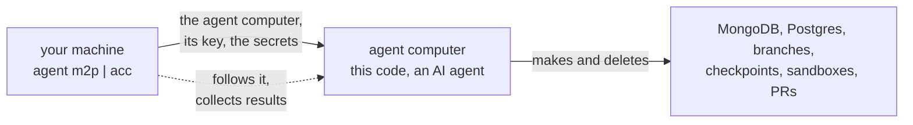

- **Your machine** only makes the agent computer; the agent does the rest, with its own Nevia key
- **Claude Code or Copilot CLI**, one setting; models through the Aiven AI gateway; both drive Nevia
  with the `nevia` CLI, the AI included, signed in with the agent's key
- **One workspace, two agents**: every name carries its agent (`m2p-…`, `acc-…`), and only those are deleted

<!--
Close the loop on the concepts: computers, branches, checkpoints and secrets, each used for what it is good at.
-->

---

<!-- _class: text -->

# What you get, and what is next

- **You get**: the loaded target, `final.sql`, a tested PR
- **Limits**: schemas inferred from samples
- **Next**: more apps, the cut-over as a step
- **Try m2p**: `agent m2p setup`, then `agent m2p run`
- **Try acc**: `agent acc setup`, then `agent acc run migrate`

<!--
The whole path is reproducible, run after run, in a dedicated Nevia workspace.
-->
