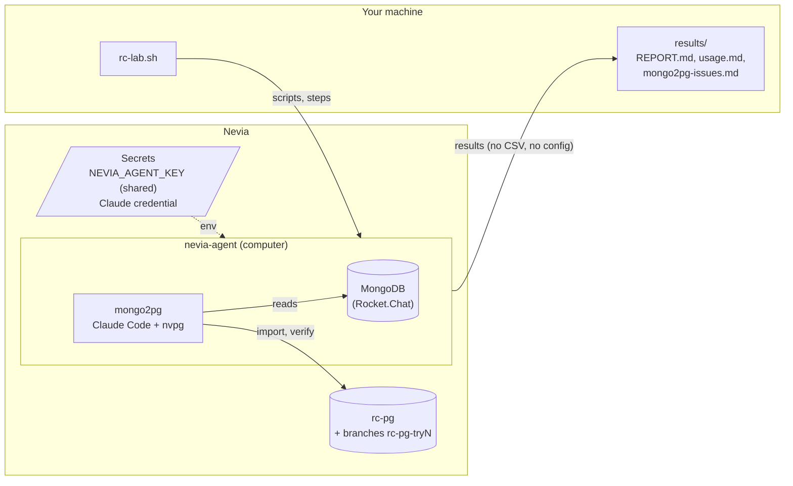
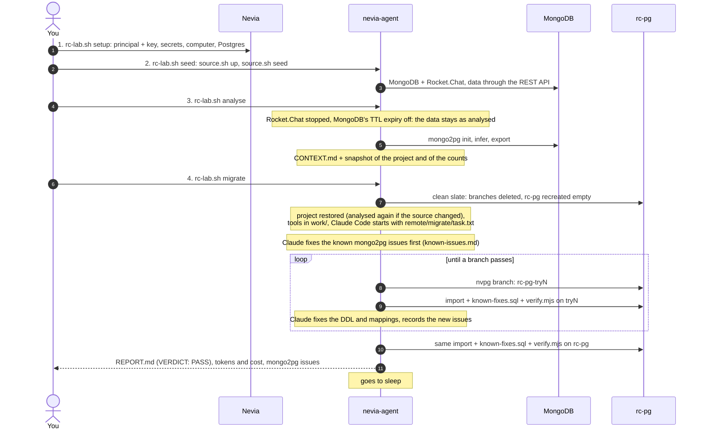
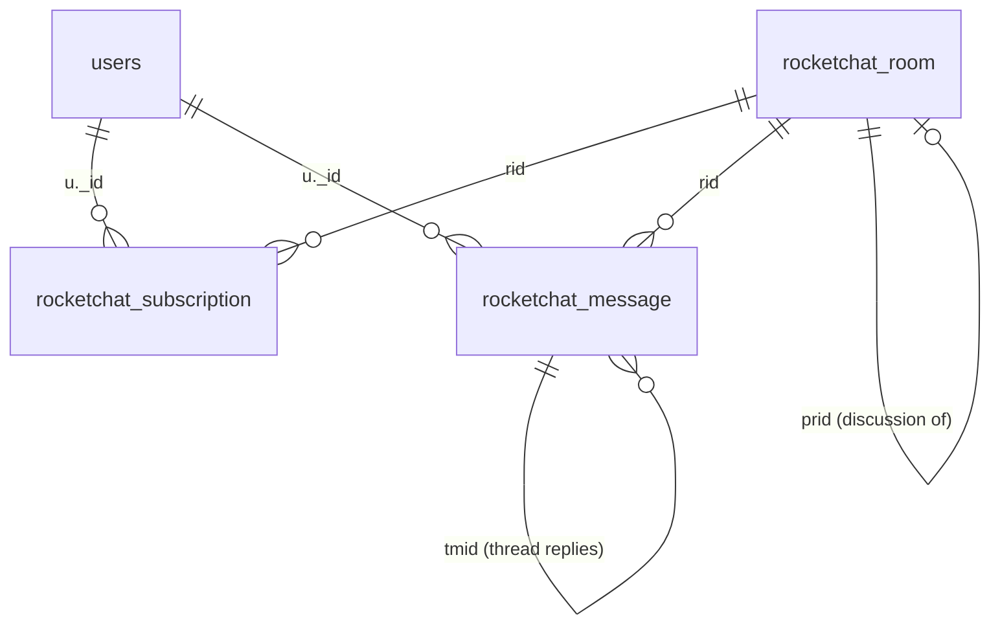

# MongoDB to Nevia Postgres

A Nevia computer migrates one MongoDB database (e.g. Rocket.Chat's) to a Nevia Postgres with mongo2pg. Steps 1 to 3 are scripts; step 4 is Claude Code alone, with one prompt: it improves the SQL mapping (DDL and mappings, never mongo2pg itself) on branches of the database until the data loads and a verification passes, then applies it to the main database.

## Architecture



## Workflow of a migration



The branch of each failed attempt stays, as it failed, until the next `migrate`. Step 2 only applies with a `SOURCE` (default `rocketchat`): for an existing MongoDB, set `SOURCE=` (empty), `MONGO_URI` and `MONGO_DB` in `.env` and skip it.

## The MongoDB model (Rocket.Chat)

The seeded database has 85 collections, 21 with documents. Four of them hold the chat itself; they link through string ids (Meteor's 17-character ids, or 24-hex ObjectIds for some), never through MongoDB references:



One document of each, as `srcmongo` shows them. The values are invented; the fields and their types are those mongo2pg inferred (run 261027081842), and a field marked *optional* is missing from some documents:

```js
// users (42): a person or a bot
{
  _id: "aB3dE5fG7hJ9kL1mN",
  username: "alice.martin", name: "Alice Martin",
  type: "user",                                   // or "bot"
  roles: ["user"],                                // "user", "admin", "bot"
  active: true,
  status: "online",                               // "online", "busy", "offline"
  emails: [{ address: "alice.martin@example.com", verified: true }],  // optional
  services: { password: { bcrypt: "$2b$10$..." }, resume: { loginTokens: [] } },  // optional
  __rooms: ["GENERAL", "pQ2rS4tU6vW8xY0zA"],      // optional: the rooms the user is in
  createdAt: ISODate("2026-10-27T08:14:02.311Z"),
  lastLogin: ISODate("2026-10-27T08:15:20.004Z"), // optional
  _updatedAt: ISODate("2026-10-27T08:16:41.950Z")
}

// rocketchat_room (37): a channel (t "c"), a private group ("p") or a direct message ("d")
{
  _id: "pQ2rS4tU6vW8xY0zA",
  t: "c",
  name: "project-apollo", fname: "project-apollo",  // optional (a DM has none)
  topic: "Launch plan",                             // optional
  u: { _id: "aB3dE5fG7hJ9kL1mN", username: "alice.martin", name: "Alice Martin" },  // optional: the owner
  usersCount: 12, msgs: 154,
  default: false, ro: false, sysMes: true,
  prid: "GENERAL",                                  // optional: the parent room of a discussion
  uids: [], usernames: [],                          // optional: the members of a DM
  lastMessage: {                                    // a copy of the room's last message
    _id: "Zx9Yw8Vu7Ts6Rq5Po", rid: "pQ2rS4tU6vW8xY0zA", msg: "Release is out :tada:",
    u: { _id: "aB3dE5fG7hJ9kL1mN", username: "alice.martin", name: "Alice Martin" },
    md: [{ type: "PARAGRAPH", value: [{ type: "PLAIN_TEXT", value: "Release is out " }] }],
    ts: ISODate("2026-10-27T08:16:54.810Z"), _updatedAt: ISODate("2026-10-27T08:16:54.810Z")
  },
  lm: ISODate("2026-10-27T08:16:54.810Z"),
  ts: ISODate("2026-10-27T08:14:30.000Z"), _updatedAt: ISODate("2026-10-27T08:16:54.810Z")
}

// rocketchat_subscription (279): a user in a room, with their unread counters
{
  _id: "Ka1Lb2Mc3Nd4Oe5Pf",
  rid: "pQ2rS4tU6vW8xY0zA", t: "c", name: "project-apollo", fname: "project-apollo",
  u: { _id: "Hn5Jm6Kp7Lq8Mr9Ns", username: "bob.durand", name: "Bob Durand" },
  open: true, alert: true,
  unread: 3, userMentions: 1, groupMentions: 0,
  tunread: ["Zx9Yw8Vu7Ts6Rq5Po"],                 // optional: threads with unread replies
  roles: ["owner"],                               // optional
  ls: ISODate("2026-10-27T08:16:00.000Z"),        // optional: last seen
  lr: ISODate("2026-10-27T08:16:00.000Z"),        // optional: last read
  ts: ISODate("2026-10-27T08:14:31.000Z"), _updatedAt: ISODate("2026-10-27T08:16:00.000Z")
}

// rocketchat_message (3 093): a message, a thread reply (tmid) or a system message (t)
{
  _id: "Zx9Yw8Vu7Ts6Rq5Po",
  rid: "pQ2rS4tU6vW8xY0zA",
  msg: "Release is out :tada: @bob.durand",
  u: { _id: "aB3dE5fG7hJ9kL1mN", username: "alice.martin", name: "Alice Martin" },
  md: [{ type: "PARAGRAPH", value: [                // optional: the parsed message
    { type: "PLAIN_TEXT", value: "Release is out " },
    { type: "EMOJI", shortCode: "tada", value: { type: "PLAIN_TEXT", value: "tada" } },
    { type: "PLAIN_TEXT", value: " " },
    { type: "MENTION_USER", value: { type: "PLAIN_TEXT", value: "bob.durand" } }
  ] }],
  mentions: [{ _id: "Hn5Jm6Kp7Lq8Mr9Ns", username: "bob.durand", name: "Bob Durand", type: "user" }],  // optional
  reactions: { ":tada:": { usernames: ["bob.durand"] }, ":rocket:": { usernames: ["carol.petit"] } },  // optional: one key per emoji
  tmid: "Wv1Ut2Sr3Qp4On5Ml",                      // optional: the thread it replies to
  tcount: 4, replies: ["Hn5Jm6Kp7Lq8Mr9Ns"],      // optional: on a thread's first message
  t: "uj",                                        // optional: a system message (user joined, topic changed...)
  attachments: [{ title: "Build", text: "green", color: "#2de0a5",  // optional
                  fields: [{ short: true, title: "Branch", value: "main" }] }],
  pinned: true, pinnedBy: { _id: "aB3dE5fG7hJ9kL1mN", username: "alice.martin" },  // optional
  editedAt: ISODate("2026-10-27T08:17:02.000Z"), editedBy: { _id: "aB3dE5fG7hJ9kL1mN", username: "alice.martin" },  // optional
  starred: [{ _id: "Hn5Jm6Kp7Lq8Mr9Ns" }],        // optional
  ts: ISODate("2026-10-27T08:16:54.810Z"), _updatedAt: ISODate("2026-10-27T08:16:54.810Z")
}
```

What makes it a test for mongo2pg: sub-objects copied into other documents (`u`, `lastMessage`), arrays of objects and of scalars (`emails`, `mentions`, `roles`), objects keyed by data (`reactions`, one key per emoji: one table per emoji in the inferred mapping), optional fields everywhere, and polymorphic values (the `value` of `md`, and of `rocketchat_settings`). The other collections are Rocket.Chat's own (`rocketchat_settings`, `rocketchat_permissions`, `rocketchat_statistics`, `rocketchat_notification_queue`, the avatars in GridFS...): `migration/rocketchat/context/CONTEXT.md` in a run's results lists them all, with their tables.

## Setup (once)

The computer is shared with uc2 and uc3 (`AGENT`, `nevia-agent` by default): its Nevia key, its sleep and its deletion are `../computer.sh`'s (see [../README.md](../README.md)); two agents may run on it at once.

Prerequisites: `nevia` (then `nevia login`) and `jq`.

```sh
cp ../.env.example ../.env    # once for uc1, uc2, uc3: set NEVIA_WORKSPACE (and UC1_SOURCE, UC1_MONGO_URI, UC1_MONGO_DB for another MongoDB)
./rc-lab.sh setup             # principal, computer, Postgres (again: renews the key)
nevia shell nevia-agent            # then: claude, /login (or CLAUDE_CODE_OAUTH_TOKEN / ANTHROPIC_API_KEY in .env, then setup again)
```

Through a gateway (e.g. Aiven's AI gateway) instead: `ANTHROPIC_BASE_URL`, `ANTHROPIC_AUTH_TOKEN` and `ANTHROPIC_MODEL` in `.env` (and the `ANTHROPIC_DEFAULT_*_MODEL` if the gateway names the models its own way), then `./rc-lab.sh setup`: the token becomes a workspace secret in the computer's env, the URL and the models go with each command. No login on the computer then, so no claude.ai connector either.

## Usage

```sh
./rc-lab.sh seed                         # 2. the source on the computer, then its data
./rc-lab.sh analyse                      # 3. mongo2pg init, infer, export, CONTEXT.md
./rc-lab.sh migrate                      # 4. Claude migrates until verified, prints the report, tokens and cost
./rc-lab.sh all                          # setup, seed, analyse, migrate
./rc-lab.sh logs [<run>]                 # follows a run again, fetches its results
./rc-lab.sh stop                         # stops the runs going (their branches stay)
./rc-lab.sh status                       # computer, containers, database and branches
./rc-lab.sh up                           # restarts the source (Rocket.Chat on the computer's URL)
./rc-lab.sh sleep                        # puts the computer to sleep (migrate does it at its end)
./rc-lab.sh destroy [--results] [--yes]  # deletes everything on Nevia (--results: results/ too)
```

The prompt is `remote/migrate/task.txt`. All settings are in `agent/.env` only, the one file of uc1, uc2 and uc3: a `UC1_` line is uc1's alone and wins over the plain one (see `agent/.env.example`). The model is `CLAUDE_MODEL`: `claude-opus-5-5` by default; `claude-sonnet-5-5` or `claude-haiku-5-5` are cheaper but may not get to `VERDICT: PASS`.

What a run costs is mostly Claude reading its context again at every turn, so the run is kept short and its context small: the tools are ready in `work/` (`verify.mjs`, `unmapped.mjs`, `known-mappings.mjs`, `known-fixes.sql`), the known mongo2pg issues are fixed before the first attempt (`remote/migrate/known-issues.md`), mongo2pg runs with `--log-level error`, a command's output is cut at `CLAUDE_BASH_MAX_OUTPUT` characters, `verify.mjs` prints only its failures, and the collections and the verification of the report are built from `verify-main.json`, not written by Claude.

## Known mongo2pg issues

`remote/migrate/known-issues.md` lists the mongo2pg issues earlier runs found, with how to see each one and how to fix it; `remote/migrate/known-fixes.sql` holds the post-import fixes that no mapping can do. Claude fixes them before the first attempt, so that a run looks for new issues only. One that still shows is recorded again as *known* (`"known": true`), so `results/mongo2pg-issues.md` tells which ones mongo2pg still has; add a new issue to `known-issues.md` once it is understood.

## Results

```
results/RUN/REPORT.md        verdict, attempts, durations, tokens and cost, Claude's report, collections and
                             verification (from verify-main.json), mongo2pg issues (new first, then known)
results/usage.md             model, tokens and cost of every run, and the total
results/mongo2pg-issues.md   every issue across runs: known or new, in how many runs, the last one it showed in
```

To look at the data:

```sh
nevia exec -t nevia-agent -- sh -c '~/m2p/bin/srcmongo'    # mongosh on the source (after analyse)
psql "$(nevia pg connect --uri rc-pg)"                # then: SET search_path = rocketchat; \dt
psql "$(nevia pg connect --uri rc-pg-try2)"           # a failed attempt, as it failed
nevia pg ls                                           # the database and its branches
```

MongoDB, one command at a time (`srcmongo` takes mongosh's arguments):

```sh
# the collections, and the documents in each
nevia exec nevia-agent -- sh -c '~/m2p/bin/srcmongo --eval "db.getCollectionNames().sort().forEach(c => print(c, db.getCollection(c).countDocuments()))"'
# one document of a collection, to see its fields
nevia exec nevia-agent -- sh -c '~/m2p/bin/srcmongo --eval "db.rocketchat_message.findOne()"'
# messages per room, the 5 busiest
nevia exec nevia-agent -- sh -c '~/m2p/bin/srcmongo --eval "db.rocketchat_message.aggregate([{ \$group: { _id: \"\$rid\", n: { \$sum: 1 } } }, { \$sort: { n: -1 } }, { \$limit: 5 }])"'
# thread replies (messages with tmid), users by role
nevia exec nevia-agent -- sh -c '~/m2p/bin/srcmongo --eval "db.rocketchat_message.countDocuments({ tmid: { \$exists: true } })"'
nevia exec nevia-agent -- sh -c '~/m2p/bin/srcmongo --eval "db.users.aggregate([{ \$unwind: \"\$roles\" }, { \$group: { _id: \"\$roles\", n: { \$sum: 1 } } }])"'
```

Postgres, the same checks (the schema is the MongoDB database's name, `rocketchat`; add `-try<N>` for a branch):

```sh
PG=$(nevia pg connect --uri rc-pg)
psql "$PG" -c '\dn'                                   # the schemas
psql "$PG" -c '\dt+ rocketchat.*'                     # the tables, with their size
psql "$PG" -c '\d rocketchat.rocketchat_message'      # one table: columns, keys, indexes
# the rows in each table, exact counts (pg_stat_user_tables only estimates them)
psql "$PG" -c "SELECT table_name, (xpath('/row/n/text()', query_to_xml(format('SELECT count(*) AS n FROM %I.%I', table_schema, table_name), false, true, '')))[1]::text::bigint AS rows
  FROM information_schema.tables WHERE table_schema = 'rocketchat' AND table_type = 'BASE TABLE' ORDER BY 1"
# messages per room, the 5 busiest: compare with MongoDB above
psql "$PG" -c 'SELECT rid, count(*) AS n FROM rocketchat.rocketchat_message GROUP BY rid ORDER BY n DESC LIMIT 5'
# the foreign keys, and whether each one has ON DELETE CASCADE
psql "$PG" -c "SELECT conrelid::regclass AS tbl, conname, pg_get_constraintdef(oid) FROM pg_constraint
  WHERE contype = 'f' AND connamespace = 'rocketchat'::regnamespace ORDER BY 1"
```

The table and column names come from the run's mapping: if one is not there, look it up with `\dt` and `\d` first.

A sleeping computer or database: `nevia awake nevia-agent --wait`, `nevia pg awake rc-pg --wait`.

## Code

On the computer, `remote/` goes to `~/m2p/scripts/`, one folder per step of the workflow (step 2, seed, is the source's: `sources/<SOURCE>/`):

```
rc-lab.sh                        on your machine: setup, the steps, follows the run, the report
lib.sh                           shared by all the scripts
remote/setup/env.sh              1. the computer: paths, the Nevia key, the tools (mongo2pg, mongosh, srcmongo, nvpg,
                                    node packages, psql); sourced by every remote script
remote/setup/status.sh              ./rc-lab.sh status on the computer
remote/analyse/analyse.sh        3. mongo2pg init, infer, export, report; CONTEXT.md; snapshot of the project and counts
remote/analyse/context.mjs          CONTEXT.md: counts, tables, infer warnings
remote/migrate/run.sh            4. clean slate, the tools in work/, Claude, the result (detached)
remote/migrate/task.txt             Claude's task
remote/migrate/known-issues.md      the known mongo2pg issues: how to see each one, how to fix it
remote/migrate/known-mappings.mjs   their mapping fixes: VARCHAR(n), UUID ids, a subtree as JSONB (--jsonb)
remote/migrate/known-fixes.sql      their post-import fixes (no mapping can do them)
remote/migrate/verify.mjs           the verification: counts, child tables, samples (random and per child table),
                                    coverage of every field with data, no VARCHAR(n), keys, the source's checks
remote/migrate/unmapped.mjs         the source fields no mapping covers
remote/migrate/nvpg                 Claude's only access to Nevia: the branches of rc-pg
remote/migrate/timing.jq            where a run's time went
sources/rocketchat/              2. the source: source.sh (up, seed, before-run, status), seed.mjs, about.txt,
                                    checks.txt and checks.mjs (its checks in verify.mjs)
```

## Security

- Claude may use file tools and a short list of commands without asking (`mongo2pg`, `psql`, `srcmongo`, `node`, `python3`, `sed`...; `ALLOWED` in `remote/migrate/run.sh`), and reaches Nevia only through `nvpg`: list, create and query the branches of `rc-pg`, no delete, no promote.
- Claude Code runs with its built-in tools only: no MCP server, no claude.ai connector of the account it is logged in with, no plugin of the computer's user settings (`--strict-mcp-config`, `ENABLE_CLAUDEAI_MCP_SERVERS=false`, `--setting-sources project,local` in `remote/migrate/run.sh`). Run 261027095359 still had 57 servers and 179 tools loaded, Gmail, Slack and Drive among them, ~180K tokens read again at every turn. The log says at the start how many tools and MCP servers it has, and warns at the end if there were any.
- Claude may not read the configs (`config/*.toml`, `config/branches/*.toml`): they hold the URIs with their passwords (`DENIED` in `remote/migrate/run.sh`).
- No database URI on a command line: `nvpg psql` and `verify.mjs` take a branch's name and get its URI themselves, and the run's log masks the password of any URI that still shows (`postgres://<redacted>@...`). Claude's raw stream (`~/m2p/runs/<run>.stream.jsonl`) stays on the computer: it holds what commands printed, URIs included.
- The computer's Nevia key (`~/m2p/.nevia-key`, valid `KEY_TTL`, 7 days) and `MONGO_URI` are on the computer, readable by Claude; `destroy` deletes the key's principal.
- No CSV and no config come back to your machine: they hold data and passwords.
- The key is *editor* on the workspace: use a dedicated workspace to isolate it.
