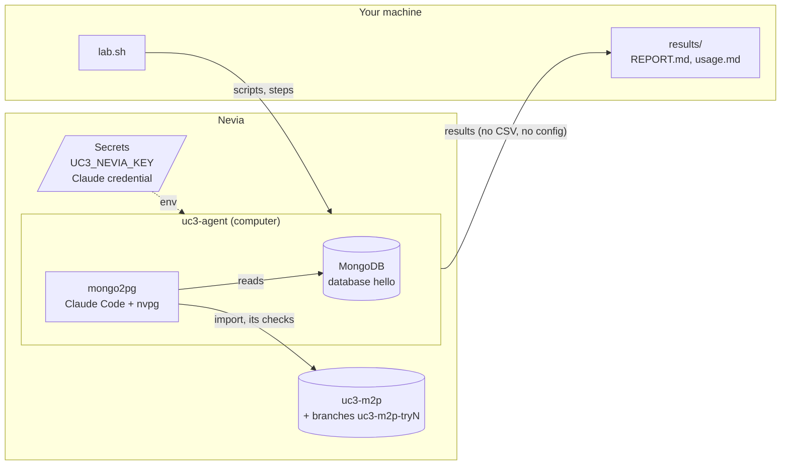
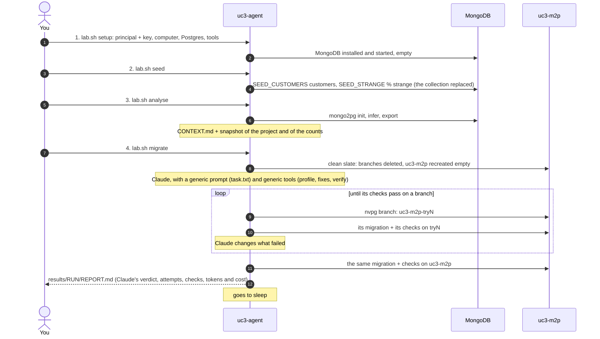

# nevia-helloworld's MongoDB to Nevia Postgres

uc1's migration, on the data of [nevia-helloworld](../../helloworld): a Nevia computer holds a MongoDB with the app's database (`hello`, its customers), migrates it to a Nevia Postgres with mongo2pg, and Claude Code improves the SQL mapping (DDL and mappings, never mongo2pg itself) on branches of the database until a verification passes, then applies it to the main database. No app is deployed: the data is generated in the shape the app stores.

## Architecture



## The four steps



1. **setup**: the computer's Nevia key (a principal, *editor*, for `nvpg`), the computer `uc3-agent`, the Postgres `uc3-m2p`, then on the computer the tools (MongoDB, mongo2pg, mongosh, the node packages, psql) and MongoDB started on `127.0.0.1:27017`. Again: renews the key.
2. **seed**: `remote/seed/seed.mjs` writes `SEED_CUSTOMERS` customers (5000 by default) into `hello.customers`, the collection replaced: the same `SEED`, the same data. Each document is one customer as the app stores it: addresses, contacts, tags, orders and their items, preferences, with optional fields and lists of every length. `SEED_STRANGE` percent of them (5 by default) are strange, one to three anomalies each, among those of `SEED_STRANGE_KINDS` (all by default): a number as a string or a Long or a Decimal128, a date as a string or epoch, nulls and empty strings, a required field missing, enums in another case, unknown fields, long text, unicode, an object where a list should be or the reverse, mixed lists, deeper nesting, an ObjectId `_id`, a duplicated order id, field names with spaces and dots. They come from a random stream of their own: the normal data stays the same whatever the percent. The seed prints how many of each it made.
3. **analyse**: mongo2pg `init`, `infer`, `export` and `report`, then `CONTEXT.md` for Claude and a snapshot of the project. Its reports come back to `results/analysis/` (replaced at each analyse). A `migrate` analyses again if the data changed since.
4. **migrate**: Claude Code with a generic prompt, `remote/migrate/task.txt`: migrate the database, all of its data, complete and correct, and prove it. It gets access (srcmongo, the mongo2pg project of analyse, `nvpg` for the branches, psql, node, python3) and **generic tools** in its work directory, which know mongo2pg and its project but not the data: `profile.mjs` (the types of every field path, over every document), `fix-mappings.mjs` (the mapping fixes of mongo2pg issues met before, from that profile: sizes, ids, NOT NULL, mixed types to TEXT; the tables and columns of the analysis kept, no JSONB added), `precheck.mjs` (every CSV value against its column, before an import), `fix-data.sql` (the data fixes no mapping can do), `unmapped.mjs` (the fields no mapping covers), `verify.mjs` (the verification of a target against the source, with every document the profile names for an odd type). It decides how to map the data and what to do with the strange documents. It imports first, without exploring (the known fixes, one regeneration, then the first attempt), and reads the data only for what an import or `verify.mjs` reports. Attempt after attempt on branches, then on the main database, **one attempt per branch**: Claude loads a branch with `mongo2pg import -c <its config>` itself, once, and a branch that `verify.mjs` failed on becomes read only, so a failure goes on to a new branch; the main database is loaded only by `nvpg import main`, after a branch has passed (`mongo2pg import` on its config is refused). Its `REPORT.md` ends with its verdict (`VERDICT: PASS` or `VERDICT: FAIL <why>`); the run fails without a PASS, or when `verify.mjs` fails on the main database. The report comes back to `results/<run>/REPORT.md`, with the run's header (attempts, durations, verify.mjs's result) and its cost: in all, per model, per attempt (an estimate) and per document migrated.

The failed attempts' branches stay, as they failed, until the next `migrate`. MongoDB stops when the computer sleeps; each step starts it again.

## Setup (once)

uc3 has a computer of its own, `uc3-agent` (`UC3_COMPUTER` in `.env`), not the one uc1 and uc2 share: its own principal and Nevia key (secret `UC3_NEVIA_KEY`), with the same rules (see [../README.md](../README.md)): `setup` makes the key only when there is none, `./lab.sh rotate-key` renews it (refused while a run is going), each process has its own key file, and nothing puts the computer to sleep under a run. `./lab.sh destroy` deletes it, with its principal and key.

Prerequisites: `nevia` (then `nevia login`) and `jq`.

```sh
cp ../.env.example ../.env    # once for uc1, uc2, uc3: set NEVIA_WORKSPACE
./lab.sh setup
nevia shell uc3-agent         # then: claude, /login (or CLAUDE_CODE_OAUTH_TOKEN, ANTHROPIC_API_KEY or a gateway in .env, then setup again)
```

## Usage

```sh
./lab.sh setup                           # 1. computer, key, Postgres, tools, MongoDB
./lab.sh seed                            # 2. the customers into MongoDB
./lab.sh analyse                         # 3. mongo2pg
./lab.sh migrate                         # 4. Claude migrates until verified, then the report
./lab.sh logs [<run>]                    # follows a run again (after Ctrl-C), fetches its report
./lab.sh stop                            # stops the runs going (their branches stay)
./lab.sh destroy [--results] [--yes]     # deletes everything on Nevia (--results: results/ too)
```

All settings are in `agent/.env` only, the one file of uc1, uc2 and uc3: a `UC3_` line is uc3's alone and wins over the plain one (see `agent/.env.example`).

## Results

```
results/analysis/hello/       the last analyse: reports/main.html (mongo2pg's report), context/CONTEXT.md, the inferred
                             schemas, stats and infer warnings, mappings (source/), DDL (schema/); no CSV, no config
results/RUN/REPORT.md        Claude's verdict, attempts, durations, tokens and cost, Claude's report
results/RUN/work/            Claude's scripts and checks, as it left them
results/usage.md             model, tokens and cost of every run, and the total
```


## Look at the data

MongoDB is on the computer: `srcmongo` is mongosh on the database `hello`. Interactively: `nevia shell uc3-agent`, then `~/uc3/bin/srcmongo`. One command at a time:

```sh
M() { nevia exec uc3-agent -- sh -c "~/uc3/bin/srcmongo --eval '$1'"; }   # a helper for this shell

M 'db.getCollectionNames().forEach(c => print(c, db.getCollection(c).countDocuments()))'   # collections, documents
M 'printjson(db.customers.findOne({ _id: "C-S00042" }))'                                    # one customer
M 'db.customers.aggregate([{ $group: { _id: "$status", n: { $sum: 1 } } }, { $sort: { n: -1 } }]).forEach(printjson)'
# what Postgres must hold: orders and items, in all
M 'db.customers.aggregate([{ $unwind: "$orders" }, { $group: { _id: null, orders: { $sum: 1 }, items: { $sum: { $size: { $ifNull: ["$orders.items", []] } } } } }]).forEach(printjson)'
# the strange documents (lab.sh seed, SEED_STRANGE)
M 'db.customers.aggregate([{ $group: { _id: { $type: "$phone" }, n: { $sum: 1 } } }]).forEach(printjson)'   # the types of a field
M 'print(db.customers.countDocuments({ _id: { $type: "objectId" } }))'                                    # ObjectId ids
M 'print(db.customers.countDocuments({ addresses: { $exists: true, $not: { $type: "array" } } }))'       # an object for a list
M 'printjson(db.customers.findOne({ "orders.items.unitPrice": { $type: "string" } }, { "orders.items": 1 }))'
```

Postgres: the schema is `hello`; the tables and their columns are the ones Claude chose (`\dt`, `\d` first; the run's `REPORT.md` lists them). Add `-try<N>` for a branch, as it was when the attempt ended:

```sh
PG=$(nevia pg connect --uri uc3-m2p)                 # uc3-m2p-try2: a branch
psql "$PG" -c '\dt+ hello.*'                           # the tables, with their size
psql "$PG" -c '\d hello.customers'                     # one table: columns, keys, indexes
# the rows of every table, exact counts
psql "$PG" -c "SELECT table_name, (xpath('/row/n/text()', query_to_xml(format('SELECT count(*) AS n FROM %I.%I', table_schema, table_name), false, true, '')))[1]::text::bigint AS rows
  FROM information_schema.tables WHERE table_schema = 'hello' AND table_type = 'BASE TABLE' ORDER BY 1"
psql "$PG" -c 'SELECT status, count(*) FROM hello.customers GROUP BY 1 ORDER BY 2 DESC'   # as in MongoDB above
psql "$PG" -c "SELECT * FROM hello.customers WHERE id = 'C-S00042'"                     # the id column: \d first
# the foreign keys, and whether each one has ON DELETE CASCADE
psql "$PG" -c "SELECT conrelid::regclass AS tbl, conname, pg_get_constraintdef(oid) FROM pg_constraint
  WHERE contype = 'f' AND connamespace = 'hello'::regnamespace ORDER BY 1"
nevia pg ls                                            # the database and its branches
```

## Code

On the computer, `remote/` goes to `~/uc3/scripts/`, one folder per step:

```
lab.sh                        on your machine: the steps, follows the run, the report
lib.sh                        shared by all the scripts
remote/setup/env.sh           the computer: paths, the Nevia key, MongoDB (mongo_up), the tools; sourced by every step
remote/setup/setup.sh         1. the tools, MongoDB started
remote/seed/seed.sh, seed.mjs 2. the customers
remote/analyse/               3. mongo2pg init, infer, export, report; CONTEXT.md (context.mjs)
remote/migrate/               4. run.sh (clean slate, the tools, Claude, the verdict), task.txt (the generic prompt),
                                 nvpg (Claude's access to the branches), timing.jq and cost.jq (where a run's time and
                                 money went), and the generic tools copied into the work directory at each run:
                                 profile.mjs, fix-mappings.mjs, precheck.mjs, fix-data.sql, unmapped.mjs, verify.mjs
```

## Security

As uc1: Claude reaches Nevia only through `nvpg` (the branches of `uc3-m2p`, no delete, no promote), runs with its built-in tools only, may not read the mongo2pg configs, and no CSV or config comes back to your machine. The computer's key is *editor* on the workspace: use a dedicated workspace.
